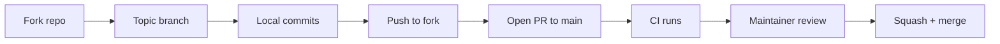

# Contributing to CheckOwners

Thanks for thinking about contributing. CheckOwners is a pure-git ownership inference engine; this guide covers the local workflow, the conventions enforced by CI, and the PR process.

## Picking work

Start from a [good first issue](https://github.com/smusali/checkowners/issues?q=is%3Aissue+is%3Aopen+label%3A%22good+first+issue%22) or any [open issue](https://github.com/smusali/checkowners/issues). Every planned change is an issue with a label for the release it ships in, such as [`v0.7.0`](https://github.com/smusali/checkowners/issues?q=is%3Aissue+is%3Aopen+label%3Av0.7.0), and its "Blocked by" list names what has to merge first. One `Upgrade to v0.x.0` issue per release pins and publishes that version.

Usage questions go to [Discussions](https://github.com/smusali/checkowners/discussions/categories/q-a). The issue tracker is for bugs, false positives, and features; those forms are required.

## Quick start

```bash
git clone https://github.com/smusali/checkowners.git
cd checkowners
pip install hatch
hatch run test
```

`hatch run test` builds the env (including `[graph]` and `[github]` via the `dev` extra), runs the suite with coverage, fails if total coverage is below 85%, and prints a branch-coverage report for `patterns.py`, `analyze.py`, `drift.py`, and `generate.py`. Everything else (lint, format, build) flows through the same environment.

Without hatch:

```bash
python -m venv .venv
source .venv/bin/activate
pip install -e ".[dev]"
pytest
```

## Common commands

| Command | What it does |
|---------|--------------|
| `hatch run test` | pytest with coverage; CI fails below 85% |
| `hatch run test -- tests/test_analyze.py --no-cov` | run a single test file without the coverage floor |
| `hatch run test -- -k "test_name" --no-cov` | run tests matching a substring without the coverage floor |
| `hatch run lint` | ruff check (including S and PTH) + mypy `--strict` |
| `hatch run fmt` | ruff format |
| `hatch build` | produce sdist and wheel in `dist/` |

CI installs from `requirements-dev.lock` with hashes. A pull request runs pytest on Ubuntu for Python 3.11, 3.12, 3.13, and 3.14, plus macOS and Windows on Python 3.14, each with the runner's Git. Each of those test jobs stops at 25 minutes. Pushes to `main`, the nightly schedule, and a manual run repeat the suite on Ubuntu, macOS, and Windows for every supported Python, and also run Ubuntu on Python 3.14 with Git 2.23.0 and Git 2.39.3. The runner's Git is the latest cell. CI then builds the wheel, smoke-tests CLI subcommands against the built artifact (including `checkowners[all]` and `py.typed`), and runs ruff plus mypy `--strict`. Match the pull-request set locally before opening a PR. A green `pytest` on macOS or Windows runs the same path corpus CI uses: spaces, Unicode, letter case, a long path, and repo-relative separators. The matcher tests also lock forward slashes, backslashes, mixed separators, drive letters, and UNC paths, with no live filesystem.

Optionally, install the pre-commit hooks so ruff, formatting, and mypy run on every commit. This repository also runs `checkowners validate` when a CODEOWNERS file changes, and `checkowners drift` on push against `.checkowners-baseline.json`.

```bash
pip install pre-commit
pre-commit install
```

`pre-commit install` registers both the commit hook and the push hook (`default_install_hook_types`). Re-run it after pulling this change if the hooks were already installed. The mypy and checkowners hooks use `.venv` or `venv` when one of those directories is present.

## Branch and PR workflow



1. Fork the repo and create a branch named after the change (`feat/topology-overlap`, `fix/validate-inline-comments`).
2. Keep commits focused; one conventional commit per logical step. Squash-and-merge is the default, so commit history inside the branch can be granular without polluting `main`.
3. Open the PR against `main`. The PR description should state the user-visible behavior change, link to any related issue, and call out follow-up work that is intentionally out of scope.
4. Wait for CI; fix anything red. Maintainers review once CI is green.

## Conventional commits

Every commit on `main` follows the [Conventional Commits](https://www.conventionalcommits.org/) spec so the changelog can be generated mechanically:

- `feat(<scope>): <subject>` for user-visible additions
- `fix(<scope>): <subject>` for bug fixes
- `docs(<scope>): <subject>` for documentation
- `chore(<scope>): <subject>` for tooling / metadata
- `ci(<scope>): <subject>` for workflow changes
- `test(<scope>): <subject>` for test-only changes

Scopes match module names (`analyze`, `drift`, `cli`, etc.) or umbrella areas (`docs`, `ci`, `security`). The commit body explains the *why* and the body lines stay wrapped at 80 columns or so.

## Code conventions

- Python 3.11 minimum through 3.14. Git 2.23.0 or newer is required at runtime because blame ignore-revs landed in that release. An older Git exits 4 with the version it found and tells you to install a newer Git. Use modern syntax (`X | Y` unions, `dict[str, int]`).
- Python 3.10 is not supported. It reaches upstream end of life in October 2026, and chasing it would only complicate the runtime. The Action installs its own interpreter. Older system Pythons are better served by standalone artifacts than by widening `requires-python`.
- Functional style. The only classes allowed are dataclasses in `models.py` and small frozen dataclasses living inside the module that returns them.
- Type hints on **every** function signature; `mypy --strict` is enforced.
- All paths via `pathlib.Path`; never hardcode strings. Ruff `PTH` enforces this.
- New CLI subcommand? Wire it in `cli.py`, give it a `--json` mode, and persist results through `state.write_state` when appropriate.
- Ownership is never binary: every owner carries an `ownership_score` in `[0.0, 1.0]` plus a separate `evidence_quality`.

## Tests

- Every module has a `tests/test_<module>.py`.
- Unit tests mock subprocess calls such as `git log` and `git blame`. They do not need a git binary.
- Integration tests build a temporary repository with the `git_repo` fixture in `tests/conftest.py`. Commits pin `GIT_AUTHOR_DATE` and `GIT_COMMITTER_DATE`. Mark them `@pytest.mark.integration`.
- Drift, patterns, generate, and validate keep both layers: mocked unit tests, and integration tests against a real git history and real CODEOWNERS text.
- `pytest -m integration` selects the integration tests. `pytest -m "not integration"` skips them. The default `pytest` run includes them, including on every pull request.
- The integration marker must finish within 60 seconds.
- `tests/test_golden.py` is the ownership judgment suite. Histories pin author and committer dates, and analysis uses a fixed as-of. Expected conclusions are keyed by `OWNERSHIP_MODEL_VERSION`. A model-version change updates that record in the same commit. The beliefs are written in `docs/METHODOLOGY.md`.
- Blame-fidelity tests may keep calling `init_git_repo` and `git_commit`.
- Git 2.23.0 or newer is required. The fixture fails if `git version` is older. The scripted repository used by the integration tests includes spaces, Unicode, a case-distinct path, and a long path. A green run on macOS or Windows executes that same corpus.
- Tests that touch `~/.checkowners/state.json` set the `CHECKOWNERS_STATE_DIR` env var so they don't clobber the contributor's real state.
- Coverage is enforced at 85% repo-wide (`--cov-fail-under=85`); new modules should land above that. The floor is a gate, not a substitute for tests against real git repositories and real CODEOWNERS files. For a focused run that should not apply the floor, pass `--no-cov`.
- `checkowners/patterns.py` also fails CI below 100% branch coverage. The cases live in `corpus/compatibility.jsonl` (pattern, path, and whole-file rules) and `corpus/realworld.jsonl` (parser fixtures from permissively licensed public repositories). `corpus/README.md` is the format other tools can load.
- Property and differential tests use Hypothesis. `HYPOTHESIS_PROFILE=ci` (the default) runs 200 examples. `HYPOTHESIS_PROFILE=nightly` runs 10,000.
- The nightly Fuzz workflow runs that profile. A shrunk failure is a JSON object with `kind`, `category`, `pattern`, `path`, and `expected`. Append it to `corpus/compatibility.jsonl` and fix the matcher. Do not commit a bot-generated file.

## Quality bar

The Fuzz workflow's `mutation` job runs on the nightly cron `0 6 * * *` and on `workflow_dispatch`. It is a sibling of the fuzz job, and it is not in `ci.yml`. The job sets `HYPOTHESIS_PROFILE=ci`. One Ubuntu runner and Python 3.14 run five `mutmut run` calls into one `mutants/` directory.

The scopes are:

- `patterns.py`, `drift.py`, and `generate.py`: every function. Local command: `mutmut run "checkowners.patterns.x*"`, and the same shape for `drift` and `generate`.
- `analyze.py` scoring: `combine_available_signals`, `signal_weights`, `signal_reliabilities`, `frequency_prior_for`, `_qualify_authors`, `score_owners`, `effective_half_life`, `_as_days`, `_bounded_half_life`, `_historical_expertise`, `_classify_freshness`, `_recency_score`, `_elapsed_days`, `frequency_credit`, `_frequency_score`, and `_clamp`.
- `github.py` identity: `resolve_noreply_handle`, `resolve_handles`, `_cached_handle`, `_rate_remaining`, `_search_budget_allows`, and `_lookup_handle`.

A scoped local run passes those names as globs, for example `mutmut run "checkowners.analyze.x_score_owners*" "checkowners.analyze.x__clamp*"`.

The score is `100 * killed / (killed + survived)`. Killed exit codes are 1, 3, and 37. Timeouts stay out of the score. The job fails when a scope has no scored mutants, and when `patterns.py` is under 90. The other four scopes publish the measured score and have no floor.

This baseline was measured with `HYPOTHESIS_PROFILE=ci`. `pattern_matches` returning `regex.match(path) is not None` is killed.

| Scope | Killed | Survived | Score |
| --- | ---: | ---: | ---: |
| `patterns.py` | 331 | 9 | 97.4 |
| `drift.py` | 770 | 13 | 98.3 |
| `generate.py` | 622 | 29 | 95.5 |
| `analyze.py` scoring | 313 | 6 | 98.1 |
| `github.py` identity | 109 | 1 | 99.1 |

These survivors leave behavior unchanged:

- `marker_layout` assigns `open_line` and `open_offset` when a block opens, so the initial `0` can be `None` or `1` without being read. The initial `manual_done` of `False` can be `None`: `None` is falsy, and a completed block assigns `True` before a repeat is checked.
- `_degenerate_globstar` can treat a body of `""` as degenerate. The only such pattern is `/`, and `_translate` already turns it into a regex that matches nothing.
- `_translate` can wrap the empty-pattern regex `(?!)` in extra literal text. The regex still matches nothing.
- `_translate_segment` reads `escaped` as a flag. `None` is falsy both at the start and after an escape is consumed.
- `_load_rules`, `_read_existing`, `ensure_overwrite_safe`, `_write_codeowners`, and `write_github_output` can pass `encoding=None` or `encoding="UTF-8"` where the source passes `"utf-8"`. `"UTF-8"` is the same codec. `None` selects the process locale, and this baseline and the nightly runner use UTF-8, so the CODEOWNERS text is unchanged. Omitting the argument selects that same locale default.
- `_compare` assigns `changed`, `notes`, and `reviews` for `commit`, `repo`, and `both` before it builds the result, so an initial `None` is unused.
- `_find_changed` can start `team_rules_skipped` at `None`. `None` is falsy, so a comparison with no team rule still omits the team note.
- `_confidence_delta` can return `1.0` for equal casefolded owner sets. `_measure_divergence` returns before that call when the sets already match.
- `drift_entry_payload` and `_reconciliation_entry` build a one-entry result so `compute_severity` can score it. That score uses qualified-owner counts, decay, and the confidence delta. `drift_detected` can be `None` or `False` on that temporary result.
- `_as_days` can subtract `0.0` instead of adding it. The day count is unchanged.
- `_bounded_half_life` can use `<=` and `>=` at the floor and ceiling. A cadence equal to either bound still returns that bound.
- `_elapsed_days` can treat `seconds < 0` like `seconds <= 0`, treat `seconds <= 1` like `seconds <= 0`, and use `/` instead of `//`. Zero and a fraction of a second still return 0, and a positive duration still truncates to whole days.
- `_search_budget_allows` can return true after the request budget is already spent. `resolve_handles` checks that budget again before a search, so no lookup runs and the budget gap is unchanged.
- `generate_codeowners`, `_build_codeowners_content`, and `_render_codeowners` can default `token` or `org` to `"XXXX"`. Team resolution runs only when both values are non-empty, and each mutant changes one default while the other stays `""`.
- `_read_existing` can return `"XXXX"` for a missing file. That text has no markers, so the manual slice stays empty.
- `_collect_rows` can sort with `key=None`. The path is the first element of each row and paths are unique, so the order matches a path sort.
- `_consolidate` can split a root path with `split("/")` or `split("/", 2)` instead of `split("/", 1)`. The first segment is the same.
- `_merge_owners` can omit `score_breakdown=None`. `None` is the field default.
- `_records_for_group` looks up paths that are already in the owner map, so the `()` default can be `None` or omitted.
- `_resolve_sanitized_rows` recurses with per-file rows only. Those rows cannot explode, so `file_owners`, `allow_broad`, and `depth` on the recursive call are unread. On the first call, `depth < 1`, `depth <= 1`, and `depth < 2` are all true, and exploding a per-file row with `or` reproduces that row.

A rewritten module gets this baseline recorded again. The workflow summary and the open issue titled `Mutation scores` show the latest run. This table is the snapshot for the tree that produced it, and the two can diverge until the baseline is recorded again.

## Dependencies

Runtime dependencies are capped at the next untested major (`typer>=0.9.0,<1`, `rich>=13.0.0,<16`, and so on). Bump a ceiling when CI proves the new major. CI installs third-party test and lint deps from `requirements-dev.lock` with hashes across Python 3.11–3.14, so interpreter-specific pins (today `pyyaml-ft`) must keep environment markers. The composite Action installs runtime extras from `requirements.lock` with hashes.

## Coverage uploads

CI uploads `coverage.xml` to Codecov with the `CODECOV_TOKEN` repository secret. Install the [Codecov GitHub App](https://github.com/apps/codecov) on the account for PR comments and status checks. If the README badge still 500s after a green upload on `main` (typical leftover state after an organization move), erase the project in Codecov's Danger Zone and let the next CI run recreate it.

## Reporting bugs

Open an issue from the [issue chooser](https://github.com/smusali/checkowners/issues/new/choose). Use the bug form for a defect, the false-positive form when inference named the wrong owner, and the feature form for a proposed change. Each form asks for the command, configuration (no tokens), repository shape, and merge strategy.

Usage questions belong in [Discussions](https://github.com/smusali/checkowners/discussions/categories/q-a), not the issue tracker.

## Security issues

Do not open public issues for vulnerabilities. Use [private vulnerability reporting](https://github.com/smusali/checkowners/security/advisories/new). You can also email <fortyone.technologies@gmail.com> with a description and a proof-of-concept. We will respond and coordinate disclosure.

## Breaking changes

A breaking change is any of:

- CLI command removal
- JSON schema changes
- scoring-model changes
- default policy changes
- Action input or output changes
- configuration schema changes

`0.x` may include those changes in a minor release when the changelog calls them out. `1.x` keeps those contracts stable until a major release.

Scoring, risk classification, and topology each have a model id (`model.ownership`, `model.risk`, `model.topology`). Changing the algorithm bumps that id. Configuration files may pin the ids this release implements; an unknown pin is refused. Cached analyze state and the graph cache are reused only when those ids match.

Append user-visible notes under `[Unreleased]` in [docs/CHANGELOG.md](CHANGELOG.md) as they merge. Leave `[Unreleased]` non-empty. A pointer to the next `Upgrade to v0.x.0` issue is enough when nothing has landed yet.
