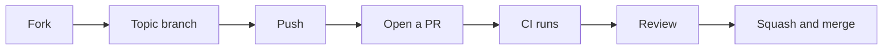

# Contributing to checkOwners

checkOwners is a pure-git ownership inference engine. This guide covers the
local workflow, the conventions CI enforces, and the pull-request process.

## Picking work

Start from a
[good first issue](https://github.com/smusali/checkowners/issues?q=is%3Aissue+is%3Aopen+label%3A%22good+first+issue%22)
or any [open issue](https://github.com/smusali/checkowners/issues). Every
planned change is an issue labeled for the release it ships in, and its blocked-by
list names what has to merge first. Usage questions go to
[Discussions](https://github.com/smusali/checkowners/discussions/categories/q-a).

## Quick start

```bash
git clone https://github.com/smusali/checkowners.git
cd checkowners
uv sync --frozen --all-extras --group dev
```

Dependencies come from `uv.lock`, and every command below runs inside that
environment.

| Command | What it does |
| --- | --- |
| `uv run pytest` | the whole suite |
| `uv run pytest tests/test_analyze.py` | one test file |
| `uv run pytest -k "test_name"` | the tests matching a substring |
| `uv run ruff check .` | lint, including the S and PTH rules |
| `uv run ruff format .` | format |
| `uv run mypy` | types, `--strict` from `pyproject.toml` |
| `uv build` | produce the sdist and wheel in `dist/` |

The documentation site uses the `docs` group:

```bash
uv sync --frozen --group docs && uv run mkdocs build
```

Optionally install the hooks so ruff, formatting, and mypy run on every commit,
plus `checkowners validate` when CODEOWNERS changes and `checkowners drift` on
push:

```bash
uv run pre-commit install
```

## Pull requests



Name the branch after the change, keep commits focused, and open the pull
request against `main`. The description states the user-visible behavior change,
links the issue, and names follow-up work that is intentionally out of scope.
Squash and merge is the default, so granular commits inside a branch are fine.

Commits follow [Conventional Commits](https://www.conventionalcommits.org/):
`feat`, `fix`, `docs`, `chore`, `ci`, or `test`, with a module name or an
umbrella area as the scope. The body explains why.

CI runs pytest on Ubuntu for Python 3.11 to 3.15 plus macOS and Windows on the
newest, each with the runner's Git. Pushes to `main`, the nightly schedule, and
a manual run add every operating system for every Python, plus Ubuntu with Git
2.23.0 and 2.39.3. CI then builds the wheel, exercises the CLI against it, and
runs ruff and `mypy --strict`.

## Conventions

- Python 3.11 to 3.15, and Git 2.23.0 or newer at runtime because blame ignore-revs landed there. An older Git exits 4 and names the version it found.
- Functional style. The classes are dataclasses, frozen where they can be.
- A type hint on every signature; `mypy --strict` is enforced over `src`, `tests`, and `tools`.
- Paths are `pathlib.Path`, which ruff `PTH` enforces.
- A new command lives in one of the `cli/` modules, takes `--json`, and persists through `state.write_state` when that makes sense.
- Ownership is never binary: an owner carries an `ownership_score` and a separate `evidence_quality`.

## Tests

- Each module has a `tests/test_<module>.py`, and the CLI suite lives in `tests/cli/`.
- Tests run the real CLI against a real temporary git repository built by the `git_repo` fixture, with author and committer dates pinned.
- `unittest.mock` appears only at the GitHub HTTP seam, `checkowners.github.request`, through the `fake_api` fixture, and at the comment-on-PR `urlopen` seam.
- Tests that touch the cache set `CHECKOWNERS_STATE_DIR` so they never write the contributor's real state.
- Property tests use Hypothesis, which runs 200 examples by default.
- `filterwarnings = ["error"]` is on, so a new warning fails the suite.

## Dependencies

Runtime dependencies are capped at the next untested major (`typer>=0.9.0,<1`,
`rich>=13.0.0,<16`, and so on); raise a ceiling when CI proves the new major.
`uv.lock` pins the development, docs, and tools groups with hashes across
Python 3.11 to 3.15. `requirements.lock` holds the runtime set alone, exported
with `uv export --no-dev --no-emit-project --extra graph`, because the composite
Action installs it with `pip --require-hashes`. Regenerate both in the commit
that changes a dependency.

## Breaking changes

Removing a command, changing the JSON schema, the scoring model, the default
policy, an Action input or output, or the configuration schema is a breaking
change. A `0.x` minor release may include one when the changelog calls it out;
`1.x` keeps those contracts stable until a major release. `1.0` additionally
means external production users and outside contributors, not a star count.

Add user-visible notes under `[Unreleased]` in [CHANGELOG.md](CHANGELOG.md) as
they merge, one line each.

## Releasing

One tagged GitHub Release produces the artifacts; nothing publishes from `main`
on its own.

1. Set `__version__` in `src/checkowners/__init__.py`.
2. Move `[Unreleased]` to a dated `## [X.Y.Z] - YYYY-MM-DD` heading, using the UTC day of the PyPI release.
3. Keep the Action pin, the committed wheel, and both lockfiles on that version. `tools/check_changelog.py` rejects a tag whose pins or heading disagree.
4. Publish the release as `vX.Y.Z`. The workflow checks the changelog, runs `uv build`, publishes with a GitHub OIDC token, writes a CycloneDX SBOM, attests the distributions, and uploads the SBOM and provenance.
5. The docs workflow deploys that version and points `latest` at it.

## Governance

Samir Musali (`@smusali`) is the only Core Maintainer and the only person with
release rights. The second maintainer seat is open. The rungs are Contributor (a
merged change), Reviewer (repeated review in an area), Maintainer (can merge
there), and Core Maintainer (release rights, and changes to these rules).

The [code of conduct](https://github.com/smusali/checkowners/blob/main/CODE_OF_CONDUCT.md)
covers behavior, and the architectural decisions are in
[Methodology](METHODOLOGY.md#decisions).

Changes here may be written with agent assistance. Every one of them is
human-reviewed, tested, and signed off before it merges.

## Reporting

Open an issue from the
[issue chooser](https://github.com/smusali/checkowners/issues/new/choose): the
bug form for a defect, the wrong-owner form when inference named the wrong
owner, the feature form for a proposal. Each asks for the command, the
configuration without tokens, the repository shape, and the merge strategy.

Supported versions and how to report a vulnerability are in the
[security policy](https://github.com/smusali/checkowners/blob/main/SECURITY.md).
