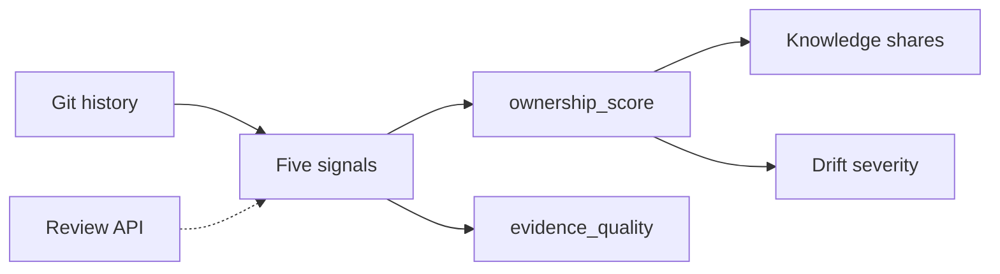

# Methodology

checkOwners scores each (path, owner) pair from the git evidence it was able to
collect, then compares the top owners of a path with the CODEOWNERS rule that
covers it.



## Signals

| Signal | Source | Weight | Reliability |
| --- | --- | --- | --- |
| Recency | `exp(-ln 2 * days_since_last_commit / half_life)` | 0.30 | 1.0 |
| Frequency | `commits / (max_commits_for_path + prior)`, prior 3 under `adaptive` | 0.20 | 1.0 |
| Blame | porcelain lines for that person over total lines | 0.20 | 1.0 |
| Reviews | reviews on pulls closed inside the review lookback | 0.15 | 1.0 |
| Change survival | current blame lines over that person's lines at their last commit | 0.15 | 1.0 |

Recency proxies whether someone still works here, frequency how often they
touch the path, blame how much of the current text is theirs, reviews the
knowledge that reading code produces, and change survival whether their work
outlived them.

```text
ownership_score  = sum(wi * ai * si) / sum(wi * ai)
evidence_quality = sum(wi * ai * ri) / sum(wi)
```

`ai` is 1 when the signal was observed for the path and 0 otherwise, so a
missing signal is skipped rather than scored as zero and the range stays
`[0, 1]` either way. A person with 0% blame still has that signal available:
that is a measured zero. `evidence_quality` is the separate question of how much
of the configured weight was actually collected, and it is never folded into the
score. Two owners can share a score and differ in quality.

Under the default `adaptive` recency strategy the half-life is the path's median
gap between commits, clamped to the floor and ceiling. Under `fixed` it is the
configured `half_life_days` for every path. The score is a ranking signal, not a
calibrated probability.

Each owner also reports `active_expertise` (their last commit, decayed),
`historical_expertise` (their commits over their commits plus later commits by
others), and `maintenance_recency` (the path's last commit, decayed).
Continuity risk is a status rather than a day count: `stable`, `inactive`,
`superseded`, or `departed`.

## Knowledge concentration

Concentration is computed over every score at or above the confidence
threshold, before the display list is truncated to `top_n_owners`. Let `pi` be
each owner's share of the score mass on one path:

- `top_owner_share` is `max(pi)`.
- `effective_owners` is `1 / sum(pi^2)`, the inverse Herfindahl index.
- `hhi` is `sum(pi^2)` and `shannon_entropy` is the entropy of `pi` in nats.
- `truck_factor_50`, `truck_factor_75`, and `truck_factor_90` are the smallest
  counts of highest-share owners whose shares reach each configured quantile.
- a major contributor holds at least `0.05`; `minor_contributor_share` is the rest.

`qualified_owner_count` is a different number: the owners at or above the
threshold in the list already truncated to `top_n_owners`. It is a capped count,
not a truck factor, and raising `top_n_owners` raises it without any code
changing hands. The repository truck factor, reported by `simulate`, greedily
removes the author who still covers the most files until covered files drop
below the first truck-factor threshold.

## Drift severity

Each drift entry scores `0.40 *` the non-overlap between declared and inferred
owners, `0.25 *` the confidence delta capped at 1, `0.15 *` the path
criticality, `0.15` when the entry is decayed, and `0.05` when the qualified
owner count is 1. Overlap is `team_coverage` for a team rule and the Jaccard
overlap otherwise, so a superset of the declared owners scores below a disjoint
set at the same delta. The default cutoffs are `0.15`, `0.35`, `0.55`, and
`0.75` for `info`, `low`, `medium`, `high`, and `critical`, and the command
severity is the worst entry.

## Terms

- **analysis completeness**: the fraction of the evidence catalog a run collected.
- **baseline**: an accepted-findings file, so later runs fail only on new findings.
- **candidate backup reviewer**: another scored person on a path, after the primary owners.
- **confidence delta**: the clamped gap between declared and inferred owners on one path.
- **criticality**: a configured weight in `(0, 1]` for a path glob, used when aggregating.
- **critical-path risk**: the criticality-weighted mean of `top_owner_share`.
- **drift**: the comparison of inferred owners with the committed rules.
- **knowledge at risk**: the share of criticality weight on paths at or below the critical threshold.
- **load signal**: what a review-load report measured: recorded reviews, a git authorship proxy, or an external provider.
- **last match wins**: the last matching CODEOWNERS pattern assigns the owners.

## Decisions

- `ownership_score` ranks; `evidence_quality` reports collection. Neither is a probability, and an unobserved signal is unavailable rather than zero.
- Pattern matching follows GitHub CODEOWNERS semantics in one engine, which `generate`, `validate`, and `drift` share. GitLab sections are a dialect on that engine, not a second matcher.
- Identity resolution is local first and search last. Search relabels one address and never merges two owners.
- Blame is `git blame --line-porcelain`, one process per path on a thread pool, cached by blob SHA. A replacement has to match porcelain line attribution.
- There is no webhook. The Action writes bounded summaries and the calling workflow, which already holds the secrets, delivers them.

## Limits

- Git history is not complete expertise, and squash merges hide authors who are absent from the commit and its trailers.
- Blame can over-credit formatting changes, which is what the ignore-revs file and the mass-refactor filter exist to reduce.
- CODEOWNERS may differ from history on purpose. Drift is a question, not a verdict.
- Team analysis, review evidence, and handle resolution for non-noreply addresses need a GitHub token.
- Identity resolution can be ambiguous, and a user-search hit can attach the wrong account.
- Trend scores use recency and frequency only, so they are not `ownership_score`.
- Repository evidence cannot prove formal ownership, decision authority, operational or incident responsibility, employment, or reviewer availability. Inferred clusters are a hypothesis, not an org chart.

## Built on

- The repository truck factor in `simulate`, after Avelino, Passos, Hora, and Valente, "A Novel Approach for Estimating Truck Factors" (ICPC 2016).
- The comparison of truck-factor algorithms, after Ferreira, Valente, and Ferreira (ICPC 2017), which is why `simulate` reports the coverage line rather than a degree-of-authorship estimate.
- Counting reviews as knowledge, after Fritz, Ou, Murphy, and Murphy-Hill (ICSE 2010) and Fritz, Murphy, Murphy-Hill, Ou, and Hill (TOSEM 2014). checkOwners does not compute degree of knowledge.
- Louvain community detection for `topology`, which is exploratory.
