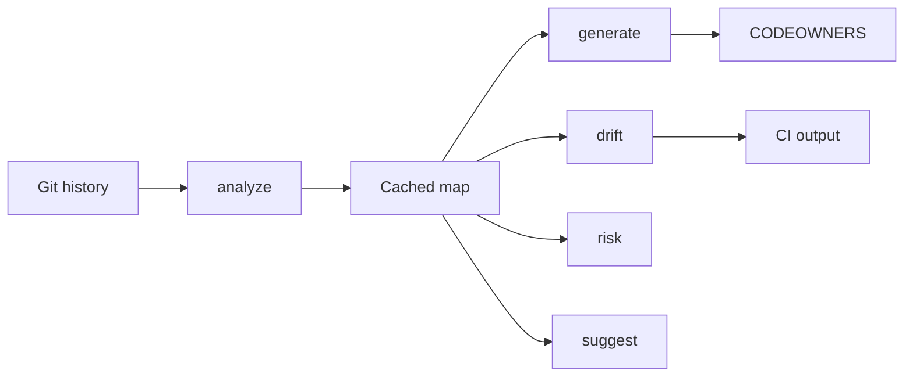

# Usage

Every command, every configuration key, and the CI integration. The scoring
model is in [METHODOLOGY.md](METHODOLOGY.md) and common questions are in
[FAQ.md](FAQ.md).

> This is a knowledge-risk tool, not a performance-measurement tool. Using it for
> individual evaluation is unsupported and harmful.

## Pipeline

`analyze` reads git history once and caches a map every other command reads.



The map lives at `~/.checkowners/state/<repo-hash>.json`, keyed by the
normalized `origin` URL so two checkouts of one remote share a file, or by the
absolute path when there is no origin. `CHECKOWNERS_STATE_DIR` moves the cache.
A command reuses the map when its commit is `HEAD` and the config hash and
package version match; otherwise it analyzes again, replaying the stored
baseline since that ref and reusing blame for unchanged blobs, which matches a
full lookback for the same repository, commit, and config.

Global flags go before the command name, as in `checkowners --allow-stale risk`:

- `--allow-stale` reuses a map whose commit is not `HEAD`.
- `--max-age SECONDS` refuses a map older than that; `0` expires immediately.
- `--no-cache` neither reads nor writes the cache.
- `--no-incremental` scores the full lookback and writes a fresh baseline.
- `--offline` makes no network call.
- `--as-of ISO8601` fixes the instant recency and decay are scored against.
- `--redact-emails` replaces addresses in output with stable tokens.
- `--diff-only SPEC` limits read-only analysis to the paths a diff touched.
- `--exit-zero` turns exit 3 into 0 after the report is printed.
- `--fail-on-incomplete` exits 3 when run completeness is below 1.
- `--verbose` prints blame cache hits and misses.

`cache info` reports sizes and this repository's state file, `cache clear`
deletes analysis state, graph files, and blame files, and `cache purge` deletes
everything including handle files and the identity graph. Those files are
evicted oldest first above 256 MiB together.

## Commands

| Command | What it does |
| --- | --- |
| `audit` | Every doctor row plus inference: drift, concentration, decay, unowned paths. Bare `checkowners` runs it |
| `doctor` | Configuration rows: branch, file size, syntax, access, teams, coverage. `--env` adds the environment |
| `analyze` | Infer ownership scores, qualified owner counts, and continuity-risk warnings |
| `print` | Print the inferred map to stdout |
| `generate` | Write CODEOWNERS ordered by ownership score |
| `validate` | Validate the committed CODEOWNERS syntax |
| `explain-path PATH` | Show which rule owns a path, and the whole match chain |
| `explain PATH` | Decompose the inferred scores. `--why-not` and `--owner` narrow it |
| `owners PATH` | The ranked owner list, and nothing else |
| `expertise PATH` | Evidence ranking for one path from the cached map |
| `drift` | Compare the committed file with the inferred map; severity and the worst score delta |
| `baseline create` | Write an accepted-findings file so later runs fail only on new findings |
| `sync` | Open a pull request proposing CODEOWNERS changes. `--commit` commits locally |
| `risk` | Rank paths by composite knowledge risk |
| `qualified-owners [PATH] [--all]` | Per-path qualified owner count with candidate backup reviewers |
| `simulate --remove @alice` | What breaks when those people leave, from the cached map |
| `suggest` | Recommend a reviewer from expertise and current load. `--diff` and `--pr` scope it to a change |
| `diff SPEC` | Ownership impact for the paths changed in `base...head` |
| `graph [--export FORMAT]` | Render the ownership graph as `dot`, `graphml`, `gexf`, or `json` |
| `topology` | Louvain clustering of collaboration. Exploratory, not an org chart |
| `onboard PATH` | Inferred onboarding suggestions. Exploratory |
| `trends` | Historical activity and qualified owner count over time |
| `report --html FILE` | Write one offline HTML report |
| `identity audit \| merge \| unmerge` | Inspect and edit the contributor identity graph |
| `cache info \| path \| clear \| purge` | Inspect and delete the on-disk cache |
| `github-action` | Run the whole CI flow and write `GITHUB_OUTPUT` |

`graph`, `topology`, and `onboard` need the `graph` extra.

## Configuration

`.github/checkowners.yml`, every field optional, defaults shown. An unknown
key exits 2 and names the line.

```yaml
analysis:
  lookback_days: 365          # integer days, or adaptive for all history
  review_lookback_days: 365   # positive integer; omit to follow lookback_days
  min_commits: 1
  top_n_owners: 3
  confidence_threshold: 0.3   # owners below this are dropped from CODEOWNERS
  respect_gitattributes: true # linguist-generated and linguist-vendored first
  max_runtime_seconds: 300    # stop blame here and mark the run incomplete
  max_git_workers: 16
  max_api_requests: 2000
  follow_renames: true
  rename_similarity: 50       # percent, 1 to 100

qualification:
  strategy: adaptive          # adaptive | threshold
  min_commits: 1              # this key wins over analysis.min_commits
  strong_blame_override: 0.5  # adaptive keeps authors at or above this share

model:                        # every signal takes weight and reliability
  signals:
    recency:
      weight: 0.30
      strategy: adaptive      # adaptive | fixed
      half_life_days: 90      # the fixed half-life, and the fallback
      half_life_floor_days: 14
      half_life_ceiling_days: 730
      reliability: 1.0
    frequency: {weight: 0.20, reliability: 1.0}
    blame: {weight: 0.20, reliability: 1.0}
    reviews: {weight: 0.15, reliability: 1.0}          # needs api_enabled
    change_survival: {weight: 0.15, reliability: 1.0}  # needs blame

bots:
  exclude: true
  additional: []              # extra addresses or handles treated as bots

decay: {threshold_days: 180, alert_on_decay: true}

bus_factor: {critical_threshold: 1, warn_threshold: 2}

criticality: {}              # path glob to weight in (0, 1]; first match wins

risk: {truck_factor_thresholds: [0.50, 0.75, 0.90]}

paths:
  exclude: ["*.lock", "dist/**", "vendor/**", "node_modules/**", "CODEOWNERS"]

output:
  header: "# Generated by checkOwners. Do not edit manually."
  include_unowned: false
  include_confidence: false   # append "# alice(0.92) bob(0.71)" to each line
  consolidate: true           # collapse a uniform directory into one dir/ rule
  max_bytes: 2500000          # refuse to write more without --force
  verify_round_trip: true     # re-resolve every generated path
  allow_broad_patterns: false
  anonymize: false
  aggregate_only: false
  block_order: manual-first   # manual-first | generated-first

drift:
  mode: commit                # commit | repo | both
  min_confidence_delta: 0.2
  hysteresis_runs: 1          # hold a severity flip until N consecutive runs
  baseline_file: ""
  severity_thresholds: [0.15, 0.35, 0.55, 0.75]

suppressions: []              # explicit and reason-required

github:
  org: ""
  resolve_handles: true
  resolve_teams: true
  api_enabled: false          # gates the review signal and the API features

git:
  blame_ignore_revs_file: .git-blame-ignore-revs
  detect_moves: true          # pass -M and -C to git blame
  mass_refactor_file_fraction: 0.5  # 0 disables; omit these commits from blame
  count_co_authors: true
  co_author_weight: 1.0       # credit per trailer, against the author's 1
  merge_strategy: auto        # auto | squash | merge | rebase

identity:
  mailmap: true               # the cheapest identity fix
  mode: handle                # handle | email | hashed
  negative_cache_ttl_days: 30 # 0 stores no miss
  do_not_merge: []            # pairs that stay two owners

identities: {}                # "@alice": {emails: [], aliases: [], service_account: false}
privacy: {redact_emails: false}
contributors:
  exclude: []
  roster: {}                  # "@bob": former | active | inactive | bot | external

policy:
  drift:                      # also single_expert, incomplete_analysis, unowned
    fail: false
    severity: warning         # error | warning; error blocks when fail is omitted
  invalid_owner:
    fail: true
    severity: error

security:
  paths: []                   # empty applies the stricter rules to nothing
  minimum_effective_owners: 2
  require_declared_owner: true
  require_active_expert: true
```

`policy.drift` covers `stale` and `changed`, `unowned` covers `missing`,
`unowned-file`, and `observed-unowned`, `single_expert` covers `single-expert`,
and `invalid_owner` covers `invalid-owner`, `owner-permission`,
`invisible-team`, `empty-team`, and `file-size`. With both set, `fail` decides
the exit and `severity` is what the report shows. A path under `security.paths`
blocks when its effective owner count is below `minimum_effective_owners`, when
it has no declared owner, or when no owner is `stable`. The token is never read
from this committed file: `github.token` is rejected, so set `GITHUB_TOKEN`.

### Environment variables

| Variable | Role |
| --- | --- |
| `CHECKOWNERS_CONFIG` | Config path, relative to the repository root or absolute. Wins over `.github/checkowners.yml` |
| `CHECKOWNERS_DRIFT_MODE` | `commit`, `repo`, or `both`. Wins over `drift.mode` |
| `CHECKOWNERS_BASELINE` | Accepted-findings path. Wins over `drift.baseline_file` |
| `CHECKOWNERS_STATE_DIR` | Cache root. Wins over `~/.checkowners` |
| `GITHUB_TOKEN` | The only supported token source |
| `GITHUB_REPOSITORY` | `owner/repo` for the review, topology, and suggest API features |
| `GITHUB_OUTPUT` | `github-action` writes bounded summaries here |
| `SOURCE_DATE_EPOCH` | POSIX seconds used as the analysis instant when `--as-of` is omitted |

## Determinism

Scoring is a pure function of the repository, the commit, and the config.
Recency and decay age against one resolved instant, never the wall clock:
`--as-of`, then `SOURCE_DATE_EPOCH`, then the HEAD committer timestamp. JSON
carries `head_sha` and `generated_at`, and `git log` is pinned to that instant,
so the same commit scored twice is byte identical.

## Identity

A `.mailmap` at the repository root is the cheapest accuracy fix: git already
collapses one person's addresses, and checkOwners applies that first, offline.
Commit emails then become GitHub `@handles` in this order:

1. An entry under `identities`, which wins over everything below.
2. `.mailmap`, unless `identity.mailmap` is false.
3. Noreply parsing, with no token and no network: `12345+login@users.noreply.github.com` becomes `@login`.
4. This repository's handle cache under `~/.checkowners/handles/`. A miss is skipped for `identity.negative_cache_ttl_days`.
5. The commit author login, when GitHub linked the commit to an account.
6. The GitHub user-search API, which needs a token and can attach the wrong account.

`--offline` or an empty token skips the last two steps. Evidence quality is
scaled once per fresh analyze: `1.0` for a certain link, `0.75` for an
unresolved email, `0.5` for a search hit.

Each owner carries a `contributor_status` of `active`, `inactive`, `unknown`,
`former`, `bot`, or `external`. `contributors.roster` wins, then a bot account
type, then organization membership, then commit age; only the roster assigns
`former`. `identity audit` lists probable duplicates, `identity merge LEFT RIGHT
INTO` records a merge, and `identity unmerge LEFT RIGHT` keeps a pair apart.

## Privacy controls

These apply to terminal output, JSON, the graph export, the Action JSON, the job
summary, and pull-request comments. `generate` and `sync` exit 2 under
`anonymize`, `aggregate_only`, or `identity.mode: hashed`, because a CODEOWNERS
file has to name accounts.

| Setting | Effect |
| --- | --- |
| `output.anonymize` | Replace each person with a `person-` token, stable within one repository |
| `output.aggregate_only` | Omit per-person fields; keep path and repository metrics |
| `privacy.redact_emails` | Replace addresses with `email:` tokens |
| `identity.mode` | `handle`, `email`, or `hashed` for how a person is named |
| `contributors.exclude` | Drop those people from analysis, reports, and export |

Addresses are stored as `email:` tokens in the cache. Changing
`contributors.exclude`, `contributors.roster`, `identities`,
`identity.do_not_merge`, `identity.negative_cache_ttl_days`, or
`bots.additional` invalidates that cache; the presentation settings do not.

## Drift

`drift` compares the inferred map with the committed CODEOWNERS using real
CODEOWNERS semantics: `*` within a segment, `**` across segments, a leading `/`
anchored to the root, a trailing `/` matching directory contents, last match
wins.

| Category | Meaning |
| --- | --- |
| `missing` | An inferred file no rule covers |
| `stale` | A rule whose pattern matches no tracked file |
| `changed` | A rule whose owners disagree with the inferred owners of its files |

Owner comparison is case insensitive, and an owner-less rule counts as
intentional coverage. When the comparison would be meaningless, for example raw
emails against `@handle` rules, drift emits a note instead of a false positive.

A rule whose owners contain `/` is a team rule. With a token, `github.org`, and
`github.resolve_teams`, drift loads the organization team list once and reports
the team as `aligned`, `partial-drift`, `unverifiable`, `invisible`, `empty`, or
`nested`. `team_coverage` is the share of inferred handles who are members.

Severity weights `0.40 *` the non-overlap, `0.25 *` the capped confidence delta,
`0.15 *` path criticality, `0.15` for a decayed entry, and `0.05` for a
qualified owner count of 1, then takes the worst tier under
`drift.severity_thresholds`; `drift.hysteresis_runs` holds a flip until the new
tier repeats. `drift --fix-plan` prints suggested edits without writing the
file, and a manual rule that disagrees with observed expertise is named for
review rather than reported as `changed`.

## Exit codes

| Code | Meaning |
| --- | --- |
| 0 | Success |
| 1 | Internal error |
| 2 | Configuration or usage error |
| 3 | Findings |
| 4 | Git or GitHub integration failure |

Every command uses these, and any non-zero status fails a CI step.
`--exit-zero` turns 3 into 0 after the report is printed, and
`--fail-on-drift` or `--no-fail-on-drift` forces `policy.drift.fail` for one run.

## GitHub Actions

```yaml
name: checkowners
on: [pull_request]

jobs:
  drift:
    runs-on: ubuntu-latest
    permissions:
      contents: read
      pull-requests: write
    steps:
      - uses: actions/checkout@v4
        with:
          fetch-depth: 0
      - uses: smusali/checkowners@v0
        with:
          mode: both
```

`@v0` tracks the latest 0.x. `@v0.7` tracks 0.7.x. `@v0.6` stays on 0.6.x. `@v0.7.0` is the pin.

`fetch-depth: 0` is required: a shallow clone has no history to score. A
comment needs `pull-requests: write`, a code scanning upload needs
`security-events: write` with `upload_sarif: true`, and a check run needs
`checks: write`. Fork pull requests skip the comment and use the job summary.

### Inputs

| Input | Default | Role |
| --- | --- | --- |
| `config` | `.github/checkowners.yml` | Config file path |
| `mode` | `commit` | Drift mode: `commit`, `repo`, or `both` |
| `include_bus_factor` | `"true"` | Emit `bus_factor_summary` |
| `include_decay` | `"true"` | Emit `decay_summary` |
| `include_balance` | `"false"` | Emit `balance_summary` |
| `max_output_entries` | `"50"` | Cap each list in the summaries |
| `fail_on_drift` | empty | Override `policy.drift.fail`; empty uses the policy |
| `baseline` | empty | Accepted-findings file |
| `comment_on_pr` | `"true"` | Maintain one pull-request comment |
| `upload_sarif` | `"false"` | Upload `checkowners.sarif` to code scanning |
| `python_version` | `"3.13"` | Interpreter to set up |
| `checkowners_version` | the Action's pin | Package version; empty uses the pin |
| `install_spec` | empty | Local extras spec for this repository only |
| `index_url` | empty | pip index for an internal mirror |
| `offline` | `"false"` | Install the committed wheel with `--no-index` |
| `github_token` | the job token | Exported as `GITHUB_TOKEN` |
| `cache` | `"true"` | Cache pip downloads and `~/.checkowners` |

### Outputs

`drift_summary`, `bus_factor_summary`, `decay_summary`, and `balance_summary`
are bounded JSON, and `artifact_name` names the artifact holding the full
payloads. `.github/workflows/checkowners.yml` in this repository is a reusable
workflow that wraps the same Action with the same inputs.

## Pre-commit

```yaml
repos:
  - repo: https://github.com/smusali/checkowners
    rev: v0.7.0
    hooks:
      - id: checkowners-validate   # on a CODEOWNERS change
      - id: checkowners-drift      # on push
```

## JSON contract

Every `--json` command validates against
[schemas/commands.schema.json](https://github.com/smusali/checkowners/blob/main/schemas/commands.schema.json),
JSON Schema draft 2020-12, one definition per command under `#/$defs`. Each
payload carries `checkowners_version`, `repository`, `head_sha`,
`generated_at`, and the analysis completeness.

## Adopting on a large repository

Run `checkowners audit` and read the findings, then `checkowners baseline
create` to accept what is already there, then add the Action with the default
policy, which blocks only invalid owners. Fix findings over time and turn
`policy.drift.fail` on at the end. `suppressions` is the explicit,
reason-required escape hatch for a finding that should stay, and writing a
`.mailmap` first is the single biggest accuracy win.
