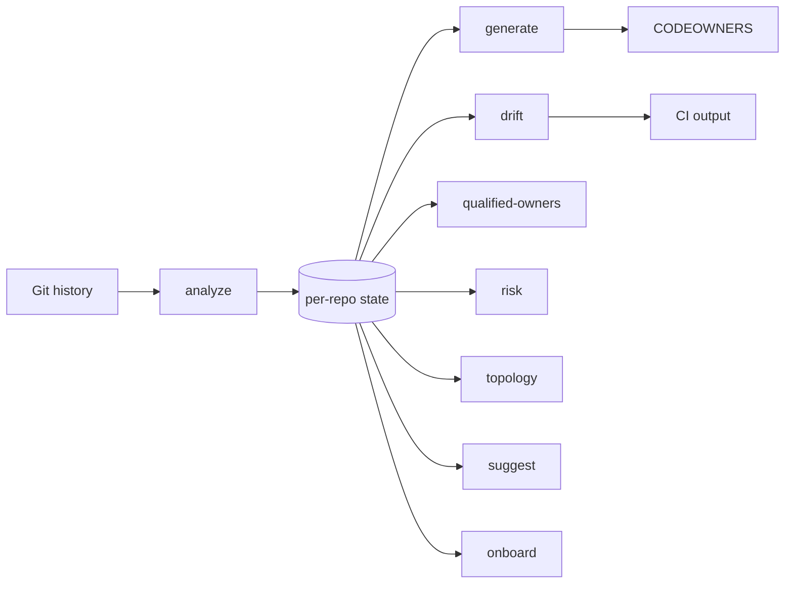
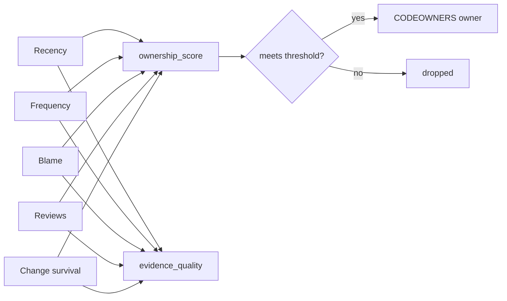

# Usage

Full configuration, scoring, and CI reference. The [README](../README.md) opens with a drift example, install, and CI. For answers to common questions see [docs/FAQ.md](FAQ.md).

## Pipeline

> This is a knowledge-risk tool, not a performance-measurement tool. Using it for individual evaluation is unsupported and harmful.



State is cached per repo at `~/.checkowners/state/<repo-hash>.json` (override the base directory with `CHECKOWNERS_STATE_DIR`). The hash is the normalized `origin` URL when the repo has one, so two checkouts of the same remote share a file. A repo with no `origin` is keyed by its absolute path.

`trends` is independent of the cached state. It runs its own `git log` pass and reports `historical_activity_confidence` (`historical-v1`), not `ownership_score`. See [Trends](#trends). `explain` and `owners` (`who`) also skip the cache. They analyze only the requested file or directory and do not write state.

Downstream commands reuse that file only when its commit is `HEAD`, its scoring config hash matches, and its model ids match. Otherwise they refresh. A usable baseline replays commits since the stored ref and reuses blame for blobs that did not change. The result matches a full lookback for the same repository, commit, config, and model. Place these flags before the command name:

```bash
checkowners --allow-stale decay
checkowners --max-age 86400 qualified-owners
checkowners --no-cache decay
checkowners --no-incremental analyze
checkowners --offline analyze
```

`--allow-stale` reuses a map whose commit is not `HEAD`. `--max-age SECONDS` refuses a map older than that many seconds (`0` expires immediately). Omit it for no age limit. `--no-cache` neither reads nor writes the analysis cache. `--no-incremental` scores the full lookback and still writes a fresh baseline. A stored baseline is not used, and the reason is printed, when the scoring config, model ids, schema, repository identity, or package version differ, when the stored commit is missing or is not an ancestor of `HEAD`, when rename detection changed, when lineage settings changed, or when the baseline does not cover the requested lookback. The first run has no baseline and does not print that notice. `--offline` makes no network calls and prints:

```text
Network access: disabled
Review evidence: unavailable
Team verification: unavailable
```

`checkowners cache path` prints the cache directory. `cache info` shows size, file counts, each stored commit, blame-cache files, and the current repository: its `repo_id`, the state file path, and whether that file exists (`--json` for the same fields). It does not print contributor emails or the ownership map. Exit 0 when that state file exists, exit 1 when this repository has no state file, and exit 2 when the working directory is not a git repository. Both the default `~/.checkowners` directory and `CHECKOWNERS_STATE_DIR` are reported the same way. `handles` is true when any per-repository handle file or a legacy `handles.json` is present. `cache clear` deletes analysis state, graph files, and blame-cache files, and keeps handle files. `cache purge` deletes everything under the cache directory, including handle files and the identity graph. State, graph, and blame-cache files are evicted oldest-first when they exceed 256 MiB together. Handle files are not evicted; purge deletes them. `--verbose` prints `blame cache: hits=N misses=M` on stderr. `--no-cache` skips blame-cache reads and writes for that run.

## Configuration

Create `.github/checkowners.yml`. Every field is optional; defaults shown. `version: 1` is required. Any other `version`, or a file with no `version`, is refused.

The numbers below are the runtime defaults. Longer-term proposals (`max_owners: 5`, different signal weights) are not applied here.

```yaml
version: 1

analysis:
  lookback_days: 365          # integer days, or adaptive (history until the analysis instant)
  review_lookback_days: 365   # positive integer; omit to follow lookback_days, including adaptive
  max_owners: 3               # was analysis.top_n_owners
  confidence_threshold: 0.3   # owners below this are dropped from CODEOWNERS
  respect_gitattributes: true # linguist-generated / linguist-vendored exclude paths first
  max_runtime_seconds: 300    # stop blame when this elapses and mark the run incomplete
  max_git_workers: 16         # parallel git blame processes
  max_api_requests: 2000      # stop GitHub calls at this count and mark the run incomplete
  follow_renames: true        # roll history onto the current path after a rename
  rename_similarity: 50       # percent, 1 to 100; git's default similarity

qualification:
  strategy: adaptive          # adaptive | threshold
  min_commits: 1              # was analysis.min_commits; this key wins if both are set
  strong_blame_override: 0.5  # adaptive: keep authors at or above this blame share

model:
  ownership: ownership-v2     # pin must match this release, or be omitted
  risk: risk-v1
  topology: topology-v2
  signals:
    recency:
      weight: 0.30
      strategy: adaptive      # adaptive | fixed; fixed uses half_life_days for every path
      half_life_days: 90      # fixed half-life, and the fallback when a path has no interval
      half_life_floor_days: 14
      half_life_ceiling_days: 730
      reliability: 1.0
    frequency:
      weight: 0.20
      reliability: 1.0
    blame:
      weight: 0.20
      reliability: 1.0
    reviews:
      weight: 0.15           # skipped (not zeroed) when github.api_enabled is false
      reliability: 1.0
    change_survival:
      weight: 0.15           # skipped when blame did not run; a zero denominator is unavailable
      reliability: 1.0

bots:
  exclude: true               # was analysis.exclude_bots; drop dependabot[bot] and similar
  additional: []              # extra addresses or handles treated as bots

decay:
  threshold_days: 180         # continuity risk when a path has no commit interval
  alert_on_decay: true

bus_factor:
  critical_threshold: 1
  warn_threshold: 2

criticality:
  "payments/**": 1.0         # first matching pattern wins; unmatched paths weigh 1.0
  "auth/**": 1.0
  "analytics/**": 0.6
  "docs/**": 0.1

risk:
  truck_factor_thresholds: [0.50, 0.75, 0.90]

paths:
  exclude:
    - "*.lock"               # fallback when gitattributes do not mark the path
    - "package-lock.json"
    - "pnpm-lock.yaml"
    - "dist/**"
    - "vendor/**"
    - "node_modules/**"
    - "*.generated.*"
    - "*.min.js"
    - "*.min.css"
    - "*.map"
    - "*.whl"
    - ".github/CODEOWNERS"   # the generated file itself is never inferred
    - "CODEOWNERS"
    - "docs/CODEOWNERS"

output:
  header: "# Generated by checkOwners. Do not edit manually."
  include_unowned: false
  include_confidence: false   # if true, append "# alice(0.92) bob(0.71)" to each line
  consolidate: true           # collapse uniform directories into one dir/ rule
  max_bytes: 2500000          # refuse to write above this without --force (GitHub ignores files over 3 MB)
  verify_round_trip: true     # re-resolve every generated path; fail on mismatch
  allow_broad_patterns: false # emit * wildcards even when they cover extra paths with different owners
  anonymize: false           # stable person tokens; no real names in output
  aggregate_only: false      # drop per-person fields; keep repository metrics
  block_order: manual-first  # manual-first | generated-first; the later block wins overlaps

drift:
  mode: commit                # commit | repo | both
  min_confidence_delta: 0.2   # suppress small-delta drift
  hysteresis_runs: 1          # severity flips on first observation; raise to require N runs
  baseline_file: ""           # accepted-findings file; fail only on new findings
  severity_thresholds: [0.15, 0.35, 0.55, 0.75]  # info, low, medium, high, critical

suppressions: []              # explicit, reason-required; see the adoption guide

github:
  org: ""
  resolve_handles: true       # overrides, noreply, cache, commit login, then search
  resolve_teams: true         # collapse owner sets to a @org/team when possible
  api_enabled: false          # gate review_weight + topology/suggest API features

git:
  blame_ignore_revs_file: .git-blame-ignore-revs
  detect_moves: true          # pass -M and -C to git blame
  mass_refactor_file_fraction: 0.5  # 0 disables; commits that modify this share of tracked files are omitted from blame
  count_co_authors: true      # credit Co-authored-by trailers
  co_author_weight: 1.0       # credit per trailer, relative to the author's 1
  merge_strategy: auto        # auto | squash | merge | rebase

identity:
  mailmap: true               # apply .mailmap in git log and git blame (default; cheapest identity fix)
  mode: handle                # handle | email | hashed
  negative_cache_ttl_days: 30 # how long a failed lookup is remembered; 0 stores no miss
  do_not_merge: []            # pairs that stay two owners even when they share a handle

identities: {}                # "@alice": {emails: [], aliases: [], service_account: false}

privacy:
  redact_emails: false        # replace addresses in output with email tokens

contributors:
  exclude: []                 # omit these people from every command and output
  roster: {}                  # "@bob": former | active | inactive | unknown | bot | external

policy:
  drift:
    fail: false               # stale and changed; set true to block novel ownership drift
    severity: warning         # error | warning; error blocks when fail is omitted
  single_expert:
    fail: false               # qualified-owner critical paths
    severity: warning
  incomplete_analysis:
    fail: false               # same exit as --fail-on-incomplete
    severity: warning
  unowned:
    fail: false               # missing CODEOWNERS coverage
    severity: warning
  invalid_owner:
    fail: true                # syntax and invalid owner tokens
    severity: error

security:
  paths: []                   # empty applies the stricter rules to nothing
  minimum_effective_owners: 2
  require_declared_owner: true
  require_active_expert: true
```

`decay`, `bus_factor`, `criticality`, `risk`, `paths`, `output`, `drift`, `github`, `git`, `identity.mailmap`, `identity.negative_cache_ttl_days`, `identity.do_not_merge`, `identities`, `contributors.roster`, `bots.additional`, and `suppressions` are part of this schema. `bus_factor` is the qualified-owner classifier. `criticality` is an ordered map of path globs to weights in `(0, 1]`. `risk.truck_factor_thresholds` is the three quantiles for `truck_factor_50`, `truck_factor_75`, and `truck_factor_90`. Mailmap is `identity.mailmap`.

Keys with no implementation yet are refused, including `model.signals.historical_depth` and `git.use_mailmap`. `policy` accepts `drift`, `single_expert`, `incomplete_analysis`, `unowned`, and `invalid_owner`, each with `fail` and `severity` (`error` or `warning`). `security` accepts `paths`, `minimum_effective_owners`, `require_declared_owner`, and `require_active_expert`. `risk` accepts only `truck_factor_thresholds`. `analysis.lookback_days` accepts an integer or `adaptive`. `analysis.review_lookback_days` accepts a positive integer and, when omitted, uses `analysis.lookback_days`. `git.count_co_authors` credits `Co-authored-by` trailers. `git.co_author_weight` is that credit relative to the author's `1`, in `[0, 1]`. `git.merge_strategy` is `auto`, `squash`, `merge`, or `rebase`. `auto` reports the dominant style in the lookback window. An explicit value is reported as given. See [Limitations](limitations.md).

`drift` covers `stale` and `changed`. `unowned` covers `missing`, `unowned-file`, and `observed-unowned`. `single_expert` covers `single-expert`. `invalid_owner` covers `invalid-owner`, `owner-permission`, `invisible-team`, `empty-team`, and `file-size`. `severity: error` blocks when `fail` is omitted. `severity: warning` does not. When both are set, `fail` decides the exit and `severity` is what the report shows. `drift` and `github-action` JSON include `policy` (the resolved checks plus `security`) and `blocking` (the novel findings that failed). A path under `security.paths` blocks when its effective owner count is below `minimum_effective_owners`, when `require_declared_owner` is true and the path has no owner, or when `require_active_expert` is true and every owner with freshness is other than `stable`. Paths outside that list, including `docs/**`, keep the global check. The Action `fail_on_drift` input overrides `policy.drift.fail` for that run. An empty input uses the file. The reported `policy.drift.fail` is the value the run used.

| Also accepted | Same setting |
| --- | --- |
| `analysis.top_n_owners` | `analysis.max_owners` |
| `analysis.min_commits` | `qualification.min_commits` |
| `analysis.exclude_bots` | `bots.exclude` |
| `scoring.recency_weight` | `model.signals.recency.weight` |
| `scoring.frequency_weight` | `model.signals.frequency.weight` |
| `scoring.blame_weight` | `model.signals.blame.weight` |
| `scoring.review_weight` | `model.signals.reviews.weight` |
| `scoring.recency_half_life_days` | `model.signals.recency.half_life_days` |
| `scoring.recency_strategy` | `model.signals.recency.strategy` |
| `scoring.recency_half_life_floor_days` | `model.signals.recency.half_life_floor_days` |
| `scoring.recency_half_life_ceiling_days` | `model.signals.recency.half_life_ceiling_days` |
| `scoring.*_reliability` | `model.signals.*.reliability` |

JSON from every command includes `models` with `ownership`, `risk`, and `topology`. Human reports print the applicable ids on stderr. Per-repo analyze state and the graph cache are reused only when all three ids match and the scoring config hash matches; a file without `models` is ignored.

The GitHub token is **never** read from this file. Set the `GITHUB_TOKEN` environment variable instead. `checkowners.yml` is committed to your repo, so storing a token here would push it to GitHub. `load_config` raises a clear error if `github.token` is present.

### Environment variables

| Variable | Who sets it | Role | Precedence |
|----------|-------------|------|------------|
| `CHECKOWNERS_CONFIG` | Action `config` input, or the user | Config file path (relative to repo root, or absolute) | Wins over `.github/checkowners.yml` |
| `CHECKOWNERS_DRIFT_MODE` | Action `mode` input, or the user | `commit` / `repo` / `both` | Applied after YAML load; wins over `drift.mode` |
| `CHECKOWNERS_BASELINE` | Action `baseline` input, or the user | Accepted-findings file path | Applied after YAML load; wins over `drift.baseline_file` |
| `CHECKOWNERS_STATE_DIR` | Action, or the user | State / handle / graph cache root | Wins over `~/.checkowners` |
| `GITHUB_TOKEN` | Action `github_token` input, or the user | Only supported token source | Never read from YAML (`github.token` is rejected) |
| `GITHUB_REPOSITORY` | GitHub runner | `owner/repo` for review coverage, topology, suggest | Required for those API features; ignored otherwise |
| `GITHUB_OUTPUT` | GitHub runner | `github-action` writes bounded `schema_version: 1` summaries when set | Full `drift.json` / `bus_factor.json` / `decay.json` payloads are the uploaded artifact; summaries stay under the 1 MB per-output cap |
| `SOURCE_DATE_EPOCH` | User or CI | Integer POSIX seconds used as the analysis instant when `--as-of` is omitted | After `--as-of`; before HEAD committer time |

With `cache: "true"` (the default), the composite Action sets `CHECKOWNERS_STATE_DIR` to `~/.checkowners` and restores that directory from the Actions cache. `cache: "false"` skips that restore and sets `CHECKOWNERS_STATE_DIR` to `${{ runner.temp }}/checkowners-state`. CLI and hand-rolled CI must set the variable themselves if they want an ephemeral cache.

## Turning checkOwners on for an existing large repository

Enabling drift on a repository that already has thousands of mismatches fails CI on day one. Capture today's findings, commit the file, and fail only on new ones.

```bash
checkowners baseline create
# writes .checkowners-baseline.json
git add .checkowners-baseline.json
```

Then pass the file to every gate:

```bash
checkowners drift --baseline .checkowners-baseline.json
```

Or set `drift.baseline_file: .checkowners-baseline.json` in `.github/checkowners.yml`, or pass the Action `baseline` input (exported as `CHECKOWNERS_BASELINE`). The CLI flag wins over the environment variable, which wins over the config key.

The file is JSON (`schema_version: "1"`) with a sorted `findings` list. Each finding is identified by `rule` plus `path` plus `owners`. Line numbers and CODEOWNERS order are not part of the identity, so reordering the file does not invalidate the baseline.

Rules that can appear: `missing`, `stale`, `changed`, `single-expert` (qualified-owner critical paths), and `invalid-owner`. Decay is not snapshotted.

When a finding is genuinely fixed, the matching baseline row is reported as stale (`stale_baseline` in JSON and "Stale baseline" in the summary). That does not fail the run. Re-run `checkowners baseline create` to shrink the file.

For a named exception that should not live in the bulk snapshot, add an explicit suppression. A reason is required. Expiry is optional. An expired row fails the command instead of keeping the silence:

```yaml
suppressions:
  - path: legacy/**
    rule: single-expert
    expires: 2026-12-31
    reason: "Scheduled for retirement in Q4"
```

`path` uses CODEOWNERS pattern matching. `rule` must be one of `missing`, `stale`, `changed`, `single-expert`, or `invalid-owner`. `drift` and `github-action` apply suppressions first, then the baseline. Both commands print `baselined`, `suppressed`, and `stale_baseline` counts so the remaining debt stays visible. Policy then decides which novel findings block. A baselined or suppressed row is reported and does not fail the run. A novel row fails only when its check has `fail: true`, or when it sits under `security.paths` and breaks that block's stricter rule.

A suppression without a reason, with an unknown rule, or with a date that is not `YYYY-MM-DD` is a configuration error at load.

## Determinism

Scoring and lookback are a pure function of the repository, the commit, and the config. Recency and decay age against one resolved instant, never the wall clock:

1. `--as-of <ISO8601>` (naive values are UTC)
2. `SOURCE_DATE_EPOCH` (integer POSIX seconds, UTC)
3. The HEAD committer timestamp (`git log -1 --format=%cI`)

`--deterministic` documents that contract. It does not change the resolution order. JSON payloads include `head_sha` (HEAD SHA) and `generated_at` (the resolved instant as ISO 8601 UTC). `git log` uses `--since` / `--until` pinned to that instant, so the same commit scored twice with a clock offset is byte-identical.

`drift.hysteresis_runs` (default `1`) holds a severity flip until the new tier appears on N consecutive drift runs, unless `max_confidence_delta` is at least `2 * min_confidence_delta`. Default `1` matches previous behavior.

## Identity resolution

Maintaining a `.mailmap` at the repository root is the cheapest, most reliable way to improve checkOwners accuracy. Git already knows how to collapse one person's addresses; checkOwners applies that mapping first, offline, with no token and no rate limit.

Commit emails are then rewritten to GitHub `@handles`, in this order:

1. **Configured identity.** An entry under `identities` wins over noreply parsing, the cache, and both GitHub calls. `emails` lists the addresses for that handle. `aliases` are display names used by `identity audit`. `service_account: true` marks the handle and its emails as bots.
2. **`.mailmap`** (default, `identity.mailmap: true`): `git log` and `git blame` emit canonical emails before any later stage sees them. Set `identity.mailmap: false` to keep raw commit addresses. There is no second mailmap pass.
3. **Noreply parsing** (no token, no network): `12345+login@users.noreply.github.com` and `login@users.noreply.github.com` become `@login`. On squash-merge repos this resolves most contributors for free.
4. **This repository's handle cache** at `~/.checkowners/handles/<repo-digest>.json`. Two checkouts of one origin share the file. A hit is reused. A miss is skipped until `identity.negative_cache_ttl_days` (default 30) has passed. `0` does not store a miss. A legacy `handles.json` is not copied into these files. `cache purge` deletes it.
5. **Commit author login** (`GET /repos/{owner}/{repo}/commits/{sha}`): `author.login` when GitHub linked the commit to an account. A null author is not a hit. This uses the core rate limit. A core rate-limit gap does not fall through to search.
6. **GitHub user-search API** (needs `GITHUB_TOKEN` and the `github` extra), and only after the commit read found no login. Search matches a public profile email and can attach the wrong account.

`--offline`, an empty token, or a missing `github` extra skips the commit read and the search. Overrides, mailmap, noreply parsing, and the cache still run. `github.resolve_handles: false` skips rewriting.

An override, a noreply address, or a commit login may collapse two owners onto one handle. Commits are summed and the path's qualified owner count is recomputed over distinct people. A search hit may relabel that one email and lowers its evidence quality. It does not collapse two owners. Pairs in `identity.do_not_merge`, and pairs split with `identity unmerge`, stay two owners.

`identity merge LEFT RIGHT INTO` records a merge and combines the stored records. `identity unmerge LEFT RIGHT` writes those records back and separates the pair so the next analyze does not merge them again. `identity audit` lists probable duplicates (the same author name, an email local-part equal to another handle, or a shared alias) and writes nothing. Pairs already merged or listed in `do_not_merge` are omitted. Under `output.aggregate_only` the JSON is only `duplicate_count`.

On a fresh analyze, evidence quality is scaled once before the state file is written: `1.0` for a certain link, `0.75` for an unresolved email, and `0.5` for a search hit. A cached load does not scale again. Qualification still uses `ownership_score`.

Each owner has `contributor_status`: `active`, `inactive`, `unknown`, `former`, `bot`, or `external`. JSON uses `contributor_status` so it does not collide with freshness `status`. The roster wins, including an explicit non-bot status. Then a `Bot` account type or a login ending in `[bot]`. Then org membership, only when `github.org` is set, a token exists, and the member list was fetched: a member with a commit inside `decay.threshold_days` is `active`, an older member is `inactive`, and a handle absent from that list is `external`. When the member list was not available, a recent commit is `active` and an older commit is `inactive`. That path never assigns `former`. `former` comes only from `contributors.roster`. Someone with no roster entry, no org list, and no commit time stays `unknown`.

`former_knowledge_share` is the share of `ownership_score` held by owners whose status is `former`, on each risk path and as a criticality-weighted repository figure on the risk summary and the owner distribution. It is `0` when nobody is former. It is a repository figure, so `output.aggregate_only` keeps it and drops `contributor_status` and `former_owners`. The knowledge-risk notice still applies. This is not a performance measure.

Analyze JSON reports `analysis.mailmap_applied` and `analysis.mailmap_file`.

## Privacy controls

Five settings change what a report may say about a person. They apply to terminal output, JSON, graph text and DOT export, Action JSON, the job summary, and pull-request comments. `generate` and `sync` exit 2 when `output.anonymize`, `output.aggregate_only`, or `identity.mode: hashed` is set, because a CODEOWNERS file has to name GitHub accounts.

| Setting | Default | Effect |
| --- | --- | --- |
| `output.anonymize` | `false` | Replace each person with a `person-` token. The token is stable for that person in that repository and different in another repository. |
| `output.aggregate_only` | `false` | Omit per-person fields, including `contributor_status` and `former_owners`. Path and repository metrics stay, including `qualified_owner_count`, `load_signal`, `former_knowledge_share`, and review-load averages. |
| `privacy.redact_emails` and `--redact-emails` | `false` | Replace email addresses in output with `email:` tokens. `--redact-emails` forces this on for one process. With redaction, `generate` skips owners that are still raw addresses. |
| `identity.mode` | `handle` | `handle` shows a GitHub login when one was resolved. `email` shows the address when the process still has it. `hashed` shows the `email:` token for addresses. |
| `contributors.exclude` | `[]` | Drop those people from analysis, reports, and graph export. Match a commit email, a `@handle`, or the stored `email:` token. Their address is not sent to the user-search API. |

Email addresses are stored as `email:` tokens in `~/.checkowners` state, the graph cache, and the per-repository handle files. `@handles` stay. Changing `contributors.exclude`, `contributors.roster`, `identities`, `identity.do_not_merge`, `identity.negative_cache_ttl_days`, or `bots.additional` invalidates the analysis cache. The other four presentation settings do not.

## Ownership scoring

Each path-owner pair gets an `ownership_score` in `[0.0, 1.0]` from the available signals only. Missing evidence is skipped, not scored as zero, so the attainable range is `[0, 1]` with or without a review provider. This number is a ranking signal, not a calibrated probability.

| Signal | Source | Weight (default) | Reliability (default) |
|--------|--------|------------------|------------------------|
| Recency | `exp(-ln 2 × days_since_last_commit / half_life)` | 0.30 | 1.0 |
| Frequency | `commits / (max_commits_for_path + prior)` (`prior` is 3 under `adaptive`, 0 under `threshold`) | 0.20 | 1.0 |
| Blame coverage | `git blame` porcelain lines / total lines, after `-w`, optional `-M`/`-C`, ignore-revs, and `.mailmap` when enabled | 0.20 | 1.0 |
| Review activity | PR reviews on pulls closed inside `analysis.review_lookback_days` (requires `github.api_enabled`) | 0.15 | 1.0 |
| Change survival | Current blame lines divided by that person's blame lines at their last commit, on the lineage path. Line counts, not an AST diff. Unavailable when blame did not run or the older count is zero | 0.15 | 1.0 |

```text
ownership_score  = Σ(wᵢ × aᵢ × sᵢ) / Σ(wᵢ × aᵢ)
evidence_quality = Σ(wᵢ × aᵢ × rᵢ) / Σ(wᵢ)
```

`aᵢ` is 1 when that signal was observed for the path (blame ran; a review provider was injected) and 0 otherwise. An author with 0% blame or 0 reviews still has that signal available: that is a measured zero, not a missing signal. `evidence_quality` is a separate quantity. Two owners can share a score and still differ in quality, for example `@alice 0.91/0.93` versus `@bob 0.79/0.31`. Human output and CODEOWNERS annotations (`output.include_confidence`) show `score/quality`.

With `scoring.recency_strategy: adaptive` (the default), the half-life is the path's median gap between commits, clamped to `recency_half_life_floor_days` and `recency_half_life_ceiling_days` (14 and 730). A path with no positive gap keeps `recency_half_life_days`. `scoring.recency_strategy: fixed` uses that configured half-life for every path. `analysis.lookback_days: adaptive` reads history until the analysis instant instead of a fixed `--since`.

Each owner also reports three evidence scores under `freshness`. They are not a measurement of what a person knows:

| Score | Meaning |
| --- | --- |
| `active_expertise` | This person's last commit, decayed by the effective half-life. This is the recency term inside `ownership_score`. |
| `historical_expertise` | This person's commits divided by their commits plus commits by anyone else after them. |
| `maintenance_recency` | The path's latest commit, decayed by the same half-life. |

Continuity risk is a status, not a day-count boolean: `stable` (no warning), `inactive`, `superseded`, or `departed` (inactive on every path). When change survival is available and below `0.2` and someone else committed later, the status is `superseded`. At or above `0.2`, later commits do not mark the owner `superseded`. When the signal is unavailable, `superseded` still means later commits by others outnumber this person's commits. `decay.threshold_days` still marks `inactive` when the path has no commit interval. `historical_expertise` counts commits. Change survival is the line-level signal for which lines remained.



Weights and reliabilities are configurable under `scoring`. Review weight is omitted from the score when `github.api_enabled` is false; it is not filled in as `0.0`. The score is clamped to `[0.0, 1.0]`; owners below `analysis.confidence_threshold` are dropped from the generated CODEOWNERS. Qualified owner count per path is the count of remaining owners after that threshold and after `analysis.top_n_owners` truncation.

Blame uses Git 2.23 or newer. The ignore-revs file is the first existing path among `git.blame_ignore_revs_file` (default `.git-blame-ignore-revs` at the repo root) and the native `blame.ignoreRevsFile` git setting.

Analyze JSON includes `analysis.ignore_revs_applied` and `analysis.ignore_revs_file` so you can see whether that correction ran. It also includes `analysis.mailmap_applied` / `analysis.mailmap_file` for `.mailmap`, and `analysis.excluded_gitattributes` / `analysis.excluded_static` for how many paths each exclusion mechanism dropped.

Paths marked `linguist-generated` or `linguist-vendored` in `.gitattributes` are excluded first when `analysis.respect_gitattributes` is true (the default). `paths.exclude` is the fallback. Set `analysis.respect_gitattributes: false` to use only the static list. Commits that modify at least `git.mass_refactor_file_fraction` of tracked files (default `0.5`) are omitted from blame the same way. Set the fraction to `0` to disable. Set `git.detect_moves: false` to skip `-M` and `-C` on blame. `analysis.follow_renames` (default true) is separate: it follows renames and copies in `git log` so a renamed file keeps its history. `analysis.rename_similarity` is the percent git must see, from 1 to 100, default 50. Set `analysis.follow_renames: false` to score each literal path on its own. `explain` shows the prior names, the logical file id, and the rename confidence. A 300-file directory rename stays within 10 seconds for that lineage pass.

Offline scores are no longer capped at `0.85`. A value of `0.72` means the same thing with or without a token. The default qualification strategy is `adaptive`: a single-commit author of a new file can appear as an owner, and low-n frequency scores are shrunk (`3` commits on an untouched path scores `0.5`, not `1.0`). Analyze JSON includes `models.ownership`, `models.risk`, and `models.topology` (`ownership-v2`, `risk-v1`, `topology-v2`). Per-repo state is schema 1; files whose model ids or schema do not match are ignored and replaced on the next analyze. Email addresses in that state are stored as tokens. `qualification.strategy: threshold` keeps a commit-count gate and undamped frequency:

```yaml
qualification:
  strategy: threshold
analysis:
  min_commits: 3
```

A bare `analysis.min_commits: 3` without `strategy: threshold` stays adaptive: authors below the bar still qualify when blame is at least `strong_blame_override`.

Blame coverage is cached by blob SHA, path, the blame flags (`-w`, `-M`, `-C`, and the mailmap flag), the ignore-revs file bytes, the mass-refactor revision list, and the `.mailmap` bytes. A hit stores integer line counts per author and rebuilds the same fractions as a fresh blame. The files live under `blame/` in the cache directory and share the 256 MiB cap with state and graph files. The blame pass runs on a thread pool sized to the CPU count. Under `adaptive` it covers every path that still has a human author after gitattributes, exclude, missing-file, and bot filters. Under `threshold` it still skips paths where no author reaches `min_commits`. Adaptive may therefore blame several times more paths than threshold; it does not blame excluded, deleted, or bot-only paths. Measured runtimes are in [benchmarks/README.md](../benchmarks/README.md). See [METHODOLOGY.md](METHODOLOGY.md) for availability rules and the full formula.

## Trends

`checkowners trends` reconstructs one snapshot per period from `git log`. Each point's `historical_activity_confidence` is the mean top score across paths that still have a scored owner. `avg_qualified_owner_count` is the mean capped count for those paths. Both use recency and frequency only.

The JSON payload sets `metric` to `historical_activity_confidence`, `model_version` to `historical-v1`, and `signals` to `recency` and `frequency`. `limitation` states that this is not `ownership_score` (`ownership-v2`, which can include blame, review, and change survival). Human output prints the same sentence. Envelope `schema_version` stays `"1"`. The point field replaces `avg_top_confidence`.

`--compare-ownership` asks to name `ownership_score` in the same report. Without `--acknowledge-different-metrics` the command exits 2 and does not print the pair. With both flags, JSON adds `compared_to` (`metric`, `model_version`, `signals`) and human output says the two metrics are not on one axis. The historical column still does not contain `ownership_score` values. Historical blame is not reconstructed.

`--periods` defaults to 6 (maximum 36). `--period-days` defaults to 30.

## Qualified owner count

`qualified_owner_count` is the number of owners on a path whose score is at or above `analysis.confidence_threshold`, taken from the list that has already been truncated to `analysis.top_n_owners` (default 3). Human output always states the cap: `3 (capped by top_n_owners=3)`. JSON emits `qualified_owner_count` and `qualified_owner_count_cap`.

This is not truck factor, bus factor, or lottery factor. Those metrics are a removal simulation over a knowledge distribution: the smallest set of contributors whose departure leaves a threshold fraction of files without an owner.

`qualified_owner_count` stays the capped threshold count. Raising `top_n_owners` raises the maximum reportable count without any code changing hands. It is not a repo-level truck factor. The formulas, the prior-art divergence, and the truncation caveat are in [Knowledge concentration](METHODOLOGY.md#knowledge-concentration).

## Departure simulation

`checkowners simulate --remove @alice --remove @bob` answers what breaks if those people leave. It reads the cached ownership map and does not collect new evidence. Repeat `--remove`, or pass `--remove-file` with one identity per line (blank lines and `#` comments are ignored). `--remove-status former` adds every cached owner with that status and can be combined with `--remove`. An unknown status exits 2. Removing nobody exits 2, the same as an empty `--remove`. An identity that is not in the map exits 2. A person who is in the map but authors no file changes nothing.

An author of a path is someone on the untruncated scored list whose ownership score is at or above `analysis.confidence_threshold`. `top_n_owners` does not cap that set. A file loses its only owner when that set had one author and they are removed. A file drops to one when at least two authors remain as exactly one. A directory is fully orphaned when every mapped file under it has no author left; the report keeps the roots of those subtrees.

The repository truck factor is the greedy count from Avelino et al.: remove the author who still covers the most files until covered files drop below `risk.truck_factor_thresholds[0]` (default `0.50`). The report shows that count before and after the named removal. Per-path `truck_factor_50`, `truck_factor_75`, and `truck_factor_90` stay the score-mass counts on one path.

Suggested transfers are candidate backup reviewers, ranked by the highest remaining ownership score under an orphaned directory, including scores below the author threshold. They are not a claim that the person is a backup reviewer.

The command refuses a missing cache, `--no-cache`, a stored commit that is not HEAD, and a cache older than `--max-age`. `--allow-stale` reuses a non-HEAD commit. It never re-analyzes. `--json` uses schema `1` (`#/$defs/simulate`) with the before/after risk distribution, repository truck factor, affected paths, and candidate transfers.

Per-path JSON also reports score mass under `risk`, computed before `top_n_owners` truncation. Expertise is `ownership_score`. `top_owner_share` is the largest share. `effective_owners` is `1 / sum(p_i^2)`. `shannon_entropy` is in nats. `hhi` is `sum(p_i^2)`. `truck_factor_50`, `truck_factor_75`, and `truck_factor_90` are the smallest owner counts whose largest shares reach the three values in `risk.truck_factor_thresholds` (default `0.50`, `0.75`, `0.90`). A major contributor has a share of at least `0.05`; `minor_contributor_share` is the rest. Changing `top_n_owners` does not change these numbers. The `bus_factor:` config section still classifies the capped count (`critical` at or below `critical_threshold`, `warning` at or below `warn_threshold`).

`checkowners qualified-owners` is the command for this count. Repository output is a distribution of `top_owner_share`, weighted by `criticality`. JSON reports `distribution.minimum`, `distribution.p10`, `distribution.median`, `distribution.p90`, `distribution.critical_path_risk` (the weighted mean of `top_owner_share`), and `distribution.knowledge_at_risk` (the share of criticality weight on paths at or below `bus_factor.critical_threshold`). The first matching `criticality` pattern wins. A path with no match weighs `1.0`. An empty `criticality` map uses that same weight and sets `distribution.criticality_incomplete` to true, because repository risk without criticality is incomplete.

## Knowledge risk

`checkowners risk` ranks each analyzed path by the composite score in [Composite risk](METHODOLOGY.md#composite-risk). `checkowners bus-factor` and `checkowners decay` are aliases. Both accept `--json` and `--baseline`. The command exits 0. Findings use the baseline and `suppressions` rules `knowledge-vacuum`, `phantom-ownership`, `shadow-maintainer`, and `ownership-review-divergence`.

`--json` is schema `1` (`#/$defs/risk`). Each entry reports `risk`, `tier`, `reason`, and the five factors `ownership_concentration`, `change_frequency`, `dependency_criticality`, `code_criticality`, and `expertise_decay`. A factor that cannot be computed is `null`. `criticality_unavailable` is true when no criticality source exists, and the text report says repository risk is incomplete without criticality. The summary reports observed ownership coverage, `knowledge_at_risk`, critical components, ownership vacuums, and high CODEOWNERS drift.

`qualified-owners` is unchanged. `github-action` still writes `bus_factor.json` and `decay.json` from the qualified-owner count and the continuity-risk list.

## Reviewer recommendation

`checkowners suggest` recommends a reviewer from expertise and current load. `checkowners balance` is an alias and prints the same report. This is a routing suggestion, not a ranking of people, and it is not for individual evaluation.

Human output always starts with `load_signal`:

- `github_completed_reviews` when the GitHub sample returned reviews
- `git_authorship_proxy` when it did not. Commit totals stay in JSON under `reviews` so older readers still see a number, and they are not review load. The text says so and recommends nobody.
- `external` when the caller supplied completed-review counts

When the signal is real reviews, each high-load person is paired with one co-owner who is not high: prefer low load, then higher `ownership_score`, then fewer completed reviews, then handle. The text looks like this:

```text
load_signal: github_completed_reviews
@alice  expertise 0.94  current load high
@bob    expertise 0.81  current load low
Recommended: @bob
qualified co-owner with lower current load
```

`expertise` is that person's highest `ownership_score`. `current load` is `high` when completed reviews, or open requests still waiting, are at least twice the average; `low` when both are at or below the average; otherwise `typical`. JSON keeps `loads`, `overloaded`, and `suggestions`, including `proposed_shift`, and adds `load_signal`. The text does not print the shift and does not list everyone.

With review history, each person can also carry `reviews_requested`, `reviews_completed`, `prs_waiting`, `median_response_time_hours`, `reviewed_lines`, `pr_complexity`, and `ownership_criticality`. Those fields are omitted on the authorship proxy. That suggest sample is still the 200 most recently updated closed pull requests. It is not the ownership review window. Open pull requests, capped at the same number, supply the waiting queue. `median_response_time_hours` is hours from pull open to that person's first submitted review. `pr_complexity` is the median of `additions + deletions` on pulls they reviewed. `ownership_criticality` is the highest configured `criticality` weight on a path they own at or above the confidence threshold. It is unset when no rule matches.

`review_concentration` is per analyzed path. It is reported when one person's share of reviews on that path is at least 0.72 and at least two owners meet the confidence threshold. A path with one knowledgeable owner is not a review monopoly. Commit share is not review concentration.

`divergence` names three roles on one path: `writer` (most commits), `reviewer` (most reviews in the sample), and `declared` (a CODEOWNERS owner who is neither). A path is omitted when any role is missing. The three are not folded into one score.

`output.aggregate_only` keeps `load_signal` and the path-level concentration and divergence lines, and drops the names and the `Recommended` line. `output.anonymize` replaces names with `person-` tokens. `--json` is schema `1` (`#/$defs/balance`) for both commands.

`checkowners suggest --diff SPEC` and `checkowners diff SPEC` score only the paths changed between the two revisions. `SPEC` is `base...head`, or one revision, which means that revision compared with `HEAD`. Removed files are left out, and paths matching `paths.exclude` are left out. `suggest --pr N` reads the changed files from the pull request. A missing token or a 403 exits 4 and names `pull-requests: read`. Neither command requests reviewers or writes the repository cache.

The long text names recommended reviewers with `ownership_score`, `evidence_quality`, the available signal scores, and how recently they touched the files. Someone in the `high` load band is listed under not recommended only when `load_signal` is `github_completed_reviews` or `external`. The authorship proxy does not demote anyone and does not treat commits as review load. The short `diff` text lists the paths, the recommended handles, ownership risks on those paths, CODEOWNERS drift for those paths, and a bus-factor regression when the qualified-owner count falls to the warn threshold. `--json` for these reports is schema `1` (`#/$defs/change`). `suggest --json` without `--diff` or `--pr` stays `#/$defs/balance`.

`--diff-only SPEC` on `analyze`, `drift`, `risk`, `bus-factor`, `decay`, `suggest`, `balance`, `explain`, `owners`, `who`, `expertise`, and `qualified-owners` limits that command to the same path set. A fresh full cache is filtered, so those paths are not blamed again. Otherwise the command scores only those paths and does not write `~/.checkowners`. An empty diff does not analyze the repository. `generate`, `sync`, `baseline`, `validate`, and `github-action` reject the flag.

## Ownership graph

`checkowners graph` prints the ownership graph as text. `--export dot` writes Graphviz DOT, which is the documented default. `--export graphml` writes GraphML, `--export gexf` writes GEXF, and `--export json` writes the node and edge lists plus an `analytics` object. An unknown format exits 2 and lists the supported formats. Install the optional `graph` extra (`networkx`) before using the command. Privacy settings apply to every export. `output.aggregate_only` drops contributor nodes. `output.anonymize` relabels them.

The graph is undirected. One pair of nodes has one edge, and that edge's `relations` attribute lists every relation the sources support. Populated nodes are contributors, files, directories, the repository, teams, and CODEOWNERS rules. Populated relations are `OWNS_OBSERVED`, `AUTHORED` when the owner has commits, `REVIEWS` when a review score exists, `DECAYING_EXPERTISE` when status is `former` or freshness is `inactive` or `departed`, `OWNS_DECLARED` from CODEOWNERS, `MEMBER_OF`, `CONTAINS`, and `DEPENDS_ON` for a Python import that resolves to another analyzed file. Package, Service, Commit, PullRequest, Review, Incident, and Domain are not nodes. `KNOWS`, `MODIFIES`, `REPLACES`, and `REVIEWED_BY` are not edges.

Text and JSON add articulation points, unweighted betweenness for contributors, and orphan files. An orphan is a file with no qualified owner whose status is outside `former` and `inactive` and whose freshness is not `inactive` or `departed`. `unknown` still counts as an expert. A Python file that imports an orphan is listed as a dependent. `--from` and `--to` resolve a handle or a path and print the shortest ownership path. A missing endpoint exits 2. Under `aggregate_only`, a person endpoint is refused. For DOT, GraphML, and GEXF the path is printed on stderr so the export stays valid. No path is a message and exits 0.

## Exploratory repository topology

`checkowners topology` is experimental. The text says the clusters are a hypothesis for a person to confirm, not an org chart. The algorithm is Louvain with seed `0`. `--resolution` defaults to `1`. Values above 1 favor smaller clusters. The report includes modularity and the mean and variance of cluster stability across seeds `0` through `4`.

Edge weight uses co-ownership, co-review when both review scores exist, and shared-module activity. Co-change and temporal collaboration are named as unavailable. A person can appear on a second cluster when their weight into it is at least half their primary weight and they connect to at least two of its members.

Declared teams are compared with Jaccard, precision, recall, and coverage. A cluster is named after a declared team only when the sets match. `--json` is schema `1` (`#/$defs/topology`) and includes `models.topology` `topology-v2`. A config pin of `topology-v1` is refused. Install the optional `graph` extra before running the command.

## Onboarding suggestions

`checkowners onboard <path>` is an experimental list of inferred suggestions, not a curriculum. When Python imports among the matched files resolve to other matched files, steps follow that order, prerequisites first. A cycle is named, and those files fall back to path order. No resolved edges means the report lists dependency order as unavailable and keeps the within-rank sort.

Within one dependency rank, files sort by qualified-owner count, then `change_events` when that value is present, then a matching `criticality` weight when a rule matches, then path. A missing signal stays missing. The `complexity` field stays `easy`, `medium`, or `hard` and is only a position tier. The step text is the reason, for example `depends on src/payments/utils.py, 2 qualified owners`.

The report lists unavailable signals in one place: code complexity, test coverage, documentation coverage, dependency order when no import graph was built, and domain criticality when no rule matches. Mentor candidates are qualified owners on the selected steps whose `contributor_status` is not `former`, `inactive`, or `bot`. They are ranked by how many of those steps have another qualified owner, then by fewer commits, then by handle, and the list is capped at three. `--json` is schema `1` (`#/$defs/onboard`). `output.aggregate_only` drops `mentor_candidates`. `output.anonymize` rewrites the handles.

## Generated CODEOWNERS

`checkowners generate` consolidates per-file inference into directory-level rules: when every inferred file under a directory shares the same owner set, one `/dir/ @owners` line replaces the per-file lines. That keeps the file reviewable and means brand-new files under the directory match a rule. Directories whose files disagree keep per-file lines. Set `output.consolidate: false` for raw per-file output. A sanitized generated file is [examples/sample-CODEOWNERS](../examples/sample-CODEOWNERS). Reference configs for a solo maintainer and an organization with teams are under [examples/](../examples/).

After building the file, generate re-resolves every path that contributed a rule with the same pattern engine used by drift (`last matching rule wins`) and fails if any path's owners differ from the set generation assigned. The error names the path, the intended owners, the resolved owners, and the winning rule line. Set `output.verify_round_trip: false` to skip this check. `--force` does not skip it. `sync` runs the same verification before it opens a pull request or, with `--commit`, before it commits.

GitHub does not load a CODEOWNERS file over 3 MB. Generate warns on stderr at 2 MB and refuses above `output.max_bytes` (default 2_500_000) unless `--force` is passed. The error names the configured limit.

GitHub ignores CODEOWNERS lines that contain `[...]` character ranges, so generate rewrites those path segments to `*`. If the rewritten pattern would also match inferred paths with a different owner set (for example `routes/[id]/` and `routes/[slug]/` both becoming `routes/*/`, which also matches `routes/static/`), generate refuses the broad rule by default, prints a warning, and emits per-file rules instead. When every newly matched path has the same owners, the wildcard is kept and recorded in JSON only. Pass `--allow-broad-patterns` or set `output.allow_broad_patterns: true` to emit the broad rule anyway. `--force` does not opt in.

`generate --json` and `sync --json` include `bytes_written`, `rules_written`, and `broad_patterns` alongside `path` and `content`. Each `broad_patterns` entry names the source pattern, the generated fallback, the extra matched paths, whether the wildcard was accepted, and the owner delta.

`checkowners explain-path <path>` shows which rule owns a path and the full match chain (every matching rule in file order, last match wins). It reads the existing CODEOWNERS and does not re-run analysis.

`generate` and `sync` refuse to overwrite a CODEOWNERS that was not generated by CheckOwners (no machine-generated header). Pass `--force` to replace a hand-written file, or to write a file larger than `output.max_bytes`.

Lines between `# checkowners:manual:start` and `# checkowners:manual:end` are copied unchanged when the file is regenerated. The rules CheckOwners writes sit between `# checkowners:generated:start` and `# checkowners:generated:end`. A file with no marker lines is still written as a normal generated file, and a file with no machine-generated header still requires `--force`.

`output.block_order` chooses the order. `manual-first` (the default) puts the manual block above the generated block, so the generated block wins when both match a path. `generated-first` puts the manual block last, so the manual rule wins those paths. Last matching rule wins either way. A manual winner is not a round-trip failure.

A start marker without its end marker, an end marker without its start, a second block of the same kind, or one kind of marker inside the other exits 2 and writes nothing.

## Sync

`checkowners sync` opens or updates one pull request titled `chore: reconcile CODEOWNERS ownership drift` on the branch `checkowners/reconcile-codeowners`. The body explains each rule change, the ownership score and evidence quality behind it, the supporting evidence, and the drift severity and direction. It states that inferred ownership is evidence, not accountability. A later run updates that open pull request instead of opening another one. The working tree stays unchanged until someone merges the pull request.

`--pr` and `--pull-request` select that default. `--dry-run` prints the diff and does not write a file, commit, or call the GitHub API. `--commit` writes CODEOWNERS and commits it on the current branch with `chore: sync CODEOWNERS via checkowners`.

Round-trip verification runs before a pull request is opened and before a commit. A failure exits 3 and publishes nothing. `--force` does not skip it. A hand-written file without the machine-generated header still requires `--force`.

`sync` keeps a manual marker block byte for byte and rewrites only the generated block. Order follows `output.block_order`. The later block wins overlapping paths. An unbalanced marker exits 2 and publishes nothing.

The pull request needs `GITHUB_TOKEN` and `owner/repo` from `GITHUB_REPOSITORY` or the `origin` remote. A job token needs `contents: write` and `pull-requests: write`. A fine-grained personal access token needs those same repository permissions. A classic personal access token needs `repo`. The repository `GITHUB_TOKEN` can open the pull request, but GitHub does not run `push` workflows from that token, and the `pull_request` workflows it creates stay waiting for approval. A personal access token or a GitHub App token is what makes those checks start on their own. checkOwners does not merge the pull request.

If the token cannot open pull requests, sync exits 4 and names `contents: write` and `pull-requests: write`.

`sync --json` keeps `committed`, which is true only for `--commit`. When a pull request is opened or updated, the payload also includes `pull_request` with `number`, `url`, and `updated`.

## Explain and owners

`checkowners explain PATH` interrogates inferred ownership for one file or directory. It does not read or write the per-repo cache. Git log and blame run only for the requested path (a directory blames the surviving files under that prefix, not the rest of the repository).

```bash
checkowners explain src/main.py
checkowners explain src/payments/
checkowners explain src/main.py --owner @alice
checkowners explain src/main.py --why-not @carol
checkowners explain src/main.py --json
```

Human output lists observed owners with each signal's score, weight, and availability. An unavailable signal is printed as `n/a`, not `0.00`. Supporting evidence names recent commit SHAs, the current-blame share, and review availability. The footer states evidence quality, the winning CODEOWNERS owners (if a file exists), team membership when the GitHub API can answer, an `aligned` / `diverged` / `unverifiable` assessment, prior names from `git log --follow` on a single file, and the configuration knobs that would change the result.

`--owner @alice` keeps one inferred contributor. `--why-not @carol` explains exclusion with concrete numbers and the threshold that was missed. A contributor below threshold and one who never touched the path produce different reasons. The two flags cannot be combined.

A directory target uses the same path matcher as `expertise`: the union of surviving files under that prefix. Each contributor's score and signal breakdown come from their highest-scoring file; commits are summed; `last_commit` is the most recent. The human header states the file count and that aggregation rule.

`checkowners owners PATH` (`who` is an alias) prints only the ranked inferred list:

```text
@alice  0.87
@bob    0.61
```

Both commands accept `--json` with `schema_version: "1"` and `models`. `explain --json` includes per-signal availability, weights, evidence, knobs, and optional `why_not`, and names each person with `handle`. `owners --json` uses `identity` and `ownership_score`.

`expertise` remains the cache-backed ranking table. `explain-path` remains the CODEOWNERS rule-chain command. Neither is a substitute for `explain`.

## Drift and severity

`checkowners drift` compares the inferred ownership against the existing CODEOWNERS and emits a JSON payload that CI can branch on.

The comparison uses real CODEOWNERS pattern semantics (gitignore-style: `*` within a segment, `**` across segments, leading `/` anchors to the repo root, trailing `/` matches directory contents, `dir/*` is direct children only, last matching rule wins), so directory and glob rules are honored:

| Category | Meaning |
|----------|---------|
| `missing` | An inferred file that no rule covers |
| `stale` | A rule whose pattern matches no tracked file (dead rule) |
| `changed` | A rule whose owners disagree with the inferred owners of files it covers, aggregated per rule and ranked by the worst per-file delta |

Owner comparison is case-insensitive, and owner-less rules (GitHub's exemption mechanism) count as intentional coverage. When comparison would be meaningless, drift emits a `note` instead of false positives: raw-email inference vs `@handle` rules (set `GITHUB_TOKEN` to resolve handles).

A rule whose owners contain `/` is a team rule. With a token, `github.resolve_teams`, and `github.org`, drift loads one org team list, records each slug, parent, and member login, and builds child links in memory. The snapshot is `teams/{org}.json` under the cache root. A run with no directory does not read that file.

| Team status | Meaning |
|-------------|---------|
| `aligned` | Every inferred handle is in the team or its descendants. `team_coverage` is 1. This is not drift. |
| `partial-drift` | Some inferred handles are outside that set. Reported as `changed` with direction `organizational_mismatch`. |
| `unverifiable` | No directory. Reason `team_membership_requires_github_api`. The `team_membership` gap stays. |
| `invisible` | The slug is missing or its member list is forbidden. |
| `empty` | The team has no members and no children. |
| `nested` | The team has children. Coverage uses the union of the team and its descendants. Cycles are ignored. |

`team_coverage` is the share of inferred handles who are members, not Jaccard. `inactive_members` are members who were not inferred. `observed_outside_team` lists inferred handles outside the set. `team_snapshot` is the directory's `fetched_at`. Individual rules keep the previous comparison.

A manual rule whose owners differ from observed expertise is not `changed`. Drift prints `declared ownership without observed expertise` and asks for a review. A generated rule with the same disagreement stays `changed`.

`checkowners drift --fix-plan` prints suggested edits and does not write CODEOWNERS. A generated replacement looks like this:

```text
-/payments/** @platform
+/payments/** @payments
```

When the declared owners should stay and someone observed is missing, the plan is a sentence: `Consider adding @alice while retaining @platform. @alice has 0.91 observed expertise and is not currently represented.` A manual rule is named for review and is not shown as a deletion. `--json` includes the same text as `fix_plan`.

Drift severity scores each entry, then takes the worst tier. The weights are `0.40 * (1 - overlap)`, `0.25 *` the confidence delta capped at 1, `0.15 *` path criticality (0 when the path matches no `criticality` pattern), `0.15` when the entry is decayed, and `0.05` when `qualified_owner_count` is 1. Overlap for a team rule is `team_coverage`. Otherwise it is the Jaccard `owner_overlap`. A superset of the declared owners therefore scores below a disjoint set when the delta is the same. A qualified-owner count of 1, or decay, does not by itself force `critical`.

`drift.severity_thresholds` is four ascending numbers in `[0, 1]`. The default is `0.15 / 0.35 / 0.55 / 0.75`. A score below the first cutoff is `info`. Then `low`, `medium`, `high`, and `critical`. No entries is `info`. The command severity is the max entry tier. Hysteresis compares these tier names.

Direction stays on `drift_type`:

| Direction | When |
|-----------|------|
| `missing_observed_expert` | An inferred path has no rule |
| `stale_declared_owner` | Declared owners are decayed and the sets still overlap |
| `complete_ownership_replacement` | Overlap is 0 and both sides are non-empty |
| `organizational_mismatch` | An inferred handle is outside the resolved team |
| `owner_mismatch` | The partial individual case that is none of those four |

`--json` always includes the `severity` field. The composite Action publishes the same field on `drift_summary`. `info` is SARIF `note`.

## Calibrate

`checkowners calibrate` scores the repository at a cutoff and compares that ranking with the people who changed each path afterward. It prints held-out `precision_at_1`, `precision_at_3`, `recall_at_3`, MRR, Brier score, and ten calibration bins. `--json` uses the shared command envelope. Reviewer overload, review latency, and time to first useful review are `unavailable` unless review history was collected.

`checkowners calibrate --fit` learns signal weights on the earliest 80 percent of labeled paths and writes them into `.github/checkowners.yml`. The file also gains a `calibration` block with the cutoff, sample sizes, default weights, and held-out metrics. The command refuses when history spans fewer than 180 days or fewer than 30 paths changed after the cutoff. It warns when the fitted weights differ from the shipped defaults by an L1 distance above 0.20. The printed result is the held-out slice.

## Report

`checkowners report --html checkowners.html` writes one HTML file. It has no external network references. The page shows the audit overview, a directory treemap sized by change volume and colored by risk, an ownership map, a `historical-v1` timeline, team alignment when declared teams were compared with observed clusters, and a drill-down of owners, `ownership_score`, `evidence_quality`, the CODEOWNERS rule, and risk. `output.anonymize` and `output.aggregate_only` apply before the file is written. The page shows the head SHA, generation time, analysis completeness, and model ids.

A 12,000-path report stays within 8 MiB. The file is the artifact to share. There is no local server.

## Doctor and audit

`checkowners doctor` reports configuration rows: the branch the file was read from against the branch GitHub consults, file size against 3 MiB, syntax, write access, empty and invisible teams, shadowed rules, declared coverage, dead patterns, and bus factor 1. `checkowners doctor --env` adds git, history, token, scopes, the CODEOWNERS path, API reachability, team visibility, review history, `.git-blame-ignore-revs`, cache writability, the package version, and whether config parsed.

Syntax uses GitHub's CODEOWNERS errors endpoint when that response is conclusive, and records `source` as `github`. Offline, or when the endpoint is unavailable, the source is `local`. A private repository whose non-default branch returns an empty error list while local syntax findings exist is `unverifiable`. It is not a clean pass. Unknown-owner and missing-access kinds from that endpoint are not syntax failures.

`checkowners audit` runs every doctor row plus inference: duplicate patterns, broad patterns (at least half of tracked files), CODEOWNERS self-protection, required code-owner review, drift, concentration, decayed declared owners, orphaned former experts, and paths with no confident observed expert. Bare `checkowners` prints that text summary. `checkowners audit --json`, `--format sarif`, and `--baseline` stay on the subcommand, so `--json` is not applied to every other command.

Audit rows that fail and whose policy check fails exit 3. `policy.invalid_owner.fail` is true, so syntax, file size, missing write access, an invisible team, and an empty team fail closed. `policy.drift.fail` and `policy.unowned.fail` stay false, so a first audit is not a red X. Warning-only rules do not block. No token, a 404, or a missing roster is `unverifiable`, never `ok`. The runtime bound is `analysis.max_runtime_seconds` (default 300). Audit does not start a second analysis when doctor already ran one.

## Exit codes

Every command uses the same status codes. Any non-zero status fails a shell step and a GitHub Actions step.

| Code | Meaning |
|------|---------|
| 0 | Success. No policy violations. |
| 1 | Internal error. |
| 2 | Configuration or usage error. Bad arguments, invalid config, a missing or unreadable baseline, or a refused overwrite. |
| 3 | Findings. `validate` syntax errors, `drift` after the baseline ratchet, expired suppressions, and a generate round-trip that does not match. |
| 4 | Git or GitHub integration failure. Git could not be run, or Git is older than 2.23. |

Place `--exit-zero` before the command name, same as `--as-of`:

```bash
checkowners --exit-zero drift --json
```

`--exit-zero` turns code 3 into 0 after the report is printed. Codes 1, 2, and 4 stay non-zero. Use it for an informational rollout. A baseline file is the other way to adopt without failing on findings that are already accepted.

`--fail-on-incomplete`, also before the command name, exits 3 when the run completeness score is below 1. `policy.incomplete_analysis.fail: true` does the same thing. Review evidence, a missing `.mailmap`, and a missing ignore-revs file are common gaps, so the flag is off by default and a normal run stays 0. `--exit-zero` still turns that 3 into 0. An analysis with no owners and no stored score has completeness 0, so the flag fails that run. A stored score below 1 fails even when every scored signal happened to be present.

`drift` and `github-action` exit 3 when a novel finding's policy check fails. `validate` exits 3 when a novel `invalid-owner` finding fails. `--fail-on-drift` forces `policy.drift.fail` on for that run, and `--no-fail-on-drift` forces it off. Omitting the flag uses the configured policy. The default policy does not block drift, single-expert paths, unowned paths, or incomplete analysis. It does block invalid owners. `--exit-zero` still turns only code 3 into 0. `--no-fail-on-drift` does not hide config errors, git failures, internal errors, or `--fail-on-incomplete`.

A git failure is not a clean result. `drift` no longer treats a failed `git ls-files` as "no stale rules."

## Pre-commit

Other repositories adopt the hooks from `.pre-commit-hooks.yaml`:

```yaml
repos:
  - repo: https://github.com/smusali/checkowners
    rev: <commit sha>
    hooks:
      - id: checkowners-validate
      - id: checkowners-drift
```

Pin `rev` to `v0.6.0` (or a later immutable tag). Pre-commit installs the package from that git ref (`language: python`).

`checkowners-validate` runs `checkowners validate` at the `pre-commit`, `pre-merge-commit`, `pre-push`, and `manual` stages. It runs only when a changed path is `CODEOWNERS`, `.github/CODEOWNERS`, or `docs/CODEOWNERS`. A syntax error exits 3 and blocks the commit. A clean file exits 0.

`checkowners-drift` runs `checkowners drift --baseline .checkowners-baseline.json` at `pre-push` only, on any pushed change. Create the baseline first:

```bash
checkowners baseline create
```

A missing or invalid baseline exits 2 and the push hook fails. Findings that remain after the baseline ratchet exit 3. A clean ratchet exits 0. A git failure exits 4.

Pre-commit treats every non-zero status as a failed hook, so 1, 2, 3, and 4 all block. `--exit-zero` is not part of either hook. Hook `args` are appended after the subcommand, and `--exit-zero` is only accepted before the subcommand, so do not pass it through `args`.

The drift hook installs the local `github` extra in its environment. Install the push hook or drift never runs:

```bash
pre-commit install --hook-type pre-commit --hook-type pre-push
```

`default_install_hook_types: [pre-commit, pre-push]` makes a plain `pre-commit install` register both.

## GitHub Actions

Least privilege (job summary only; no PR comment):

```yaml
name: checkowners
on: [pull_request]

jobs:
  drift:
    runs-on: ubuntu-latest
    permissions:
      contents: read
    steps:
      - uses: actions/checkout@v4
        with:
          fetch-depth: 0
      - uses: smusali/checkowners@v0
        with:
          config: .github/checkowners.yml
          comment_on_pr: false
```

Same-repo PR comments (`comment_on_pr` defaults to `"true"`):

```yaml
name: checkowners
on: [pull_request]

jobs:
  drift:
    runs-on: ubuntu-latest
    permissions:
      contents: read
      pull-requests: write
    steps:
      - uses: actions/checkout@v4
        with:
          fetch-depth: 0
      - uses: smusali/checkowners@v0
        with:
          config: .github/checkowners.yml
```

`@v0` tracks the latest 0.x release. `@v0.6` tracks 0.6.x patches. `@v0.5` stays on the 0.5.x line. `@v0.6.0` is the immutable pin for this release.

The action always writes the full report to the job summary. That needs no extra permissions and works on fork pull requests, where the job token is read-only regardless of the `permissions:` block. On a fork pull request the action skips commenting, emits a notice, and leaves the job green.

If `comment_on_pr` stays `"true"` under read-only workflow permissions, the comment step warns (`Grant 'pull-requests: write' or set comment_on_pr: false`) and does not fail the job. Set `comment_on_pr: false` to skip the attempt.

The composite action writes bounded JSON summaries to `GITHUB_OUTPUT` (`schema_version: 1`) so workflow gates stay under GitHub's 1 MB per-output cap. The drift output is `drift_summary`. Gates read `drift_summary.drift_detected`, `drift_summary.severity`, and `bus_factor_summary.critical_paths[0]`. Each summary includes `counts` and `truncated`. The qualified-owner summary also includes `qualified_owner_count_cap`. Drift still carries `notes` plus the top `missing` / `stale` / `changed` entries (with per-entry `qualified_owner_count` and `decay` flags). Per-path `entries` are omitted from the output; the full lists live in the uploaded artifact.

Post that drift summary to Slack when drift is present:

```yaml
- id: checkowners
  uses: smusali/checkowners@v0
- if: fromJson(steps.checkowners.outputs.drift_summary).drift_detected
  uses: slackapi/slack-github-action@v2
  with:
    webhook: ${{ secrets.SLACK_WEBHOOK_URL }}
    webhook-type: incoming-webhook
    payload: |
      text: "checkOwners drift (${{ fromJson(steps.checkowners.outputs.drift_summary).severity }})"
```

Set `max_output_entries` (default `50`) to cap each list in those summaries and in the job-summary / PR-comment report. Workflows that need every entry should `actions/download-artifact` using the `artifact_name` output (`checkowners-reports`) and branch on `schema_version`.

The composite action exports `GITHUB_TOKEN` on the `github-action` step from the `github_token` input, which defaults to `${{ github.token }}`, and passes the same token to the PR comment step. Most callers can omit the input. Override it with a PAT or App token when the default job token cannot list org teams or cannot comment. A supplied token takes precedence over `github.token`. Minimum permissions for each capability are listed in [docs/FAQ.md](FAQ.md#what-token-scopes-are-needed).

The composite action accepts `fail_on_drift`. An empty value uses `policy.drift.fail`. `"true"` blocks novel drift. `"false"` reports it without blocking. The default policy does not fail the step for drift. It also accepts `baseline` for an accepted-findings file (fail only on new findings), `include_bus_factor` / `include_decay` toggles for the secondary outputs, `include_balance` (default `"false"`) for the review-load summary, `max_output_entries` for summary size, and `comment_on_pr` (default `"true"`) which maintains a single drift + qualified-owners summary comment on same-repo pull requests, updated in place on every push and marked resolved when drift clears. The Action output key remains `bus_factor_summary` for compatibility.

The action fails fast with a clear error when it detects a shallow clone: `git log` and `git blame` need history, so the `actions/checkout` step must set `fetch-depth: 0`.

With no extra inputs, Action `vX.Y.Z` installs `checkowners==X.Y.Z` from the wheel committed next to `action.yml`, and installs third-party dependencies from `requirements.lock` with `pip install --require-hashes --only-binary :all:`. An empty `checkowners_version` uses that pin; it never installs "whatever PyPI serves today." After install, the action asserts `checkowners --version` matches the pin.

Advanced install inputs:

| Input | Default | Purpose |
|-------|---------|---------|
| `checkowners_version` | this Action's tag version | Override to install a different published version from the index. That path still uses the hashed lockfile for third-party deps, but skips hash verification for the `checkowners` package itself. |
| `index_url` | (PyPI) | pip `--index-url` for an internal mirror. |
| `offline` | `"false"` | Install the committed wheel with `--no-index --find-links`. The override must match the pin. A fully air-gapped runner also needs the lockfile wheels on disk (`pip download --require-hashes -r requirements.lock -d <dir>`) or a reachable `index_url`. |
| `install_spec` | `""` | **Security-sensitive.** Allowed only as a local extras spec for dogfooding this repository: `.`, `.[graph]`, `.[github]`, `.[graph,github]`, `.[github,graph]`, or `.[all]`. Interpolating untrusted workflow data into this input is remote code execution. Downstream callers must omit it. |
| `cache` | `"true"` | Cache pip downloads and `~/.checkowners`. `"false"` skips both. |

`cache: "false"` turns off the pip cache and the state cache. A warm run reuses the ownership map only when the stored commit is still `HEAD` and the config hash and model versions match. A restored ancestor baseline is applied incrementally. A restored commit that is not an ancestor of `HEAD`, or a baseline whose config or model ids do not match, is scored again from the full lookback, and the reason is printed.

`drift`, `risk`, and `validate` accept `--format text`, `--format json`, `--format sarif`, and `--format junit`. `--json` is still `--format json`. If both are set and they disagree, the command exits 2. SARIF and JUnit write only that document to stdout. Exit codes are unchanged: blocking findings still exit 3 after the document is printed. `drift` still writes `GITHUB_OUTPUT`.

The SARIF rules are `checkowners/unowned-path`, `checkowners/stale-owner`, `checkowners/ownership-drift`, `checkowners/invalid-owner`, `checkowners/shadowed-rule`, `checkowners/single-expert-risk`, and `checkowners/incomplete-analysis`, plus the audit ids `owner-permission`, `invisible-team`, `empty-team`, `file-size`, `unowned-file`, `observed-unowned`, `duplicate-rule`, `broad-rule`, `self-protection`, `ruleset`, `decayed-owner`, and `orphaned-owner`. Every run lists the full set. `critical`, `high`, and policy `error` are SARIF `error`. `medium` and policy `warning` are `warning`. `low` and `info` are `note`. The fingerprint is the baseline identity of rule, path, and owners, so a later severity change does not open a new alert. Shadowed rules are reported in SARIF and JUnit only. The default `validate` text stays syntax-only.

The composite action writes `checkowners.sarif` and `checkowners.junit.xml` next to the JSON reports. `upload_sarif` defaults to `"false"`. Set it to `"true"` and grant `security-events: write` to upload the file with category `checkowners`. Fork and Dependabot pull requests skip that upload, because their token cannot be given the scope, and the job stays green. The artifact is still uploaded. A privileged `workflow_run` workflow can download that artifact and upload it for fork pull requests. That workflow file has to be on the default branch before GitHub will run it. This repository ships `.github/workflows/checkowners-sarif-upload.yml` for the dogfood workflow.

When `GITHUB_ACTIONS` is set, findings are also workflow annotations on the real file and line, capped at 50. The step summary says how many more there are. The action creates a check run named checkOwners when `GITHUB_TOKEN`, `GITHUB_SHA`, and `GITHUB_REPOSITORY` are set. The conclusion is `failure` only when the run will exit 3. A missing token or an HTTP 401, 403, or 404 does not fail the job. Grant `checks: write` for that check run.

`.github/workflows/checkowners.yml` is a reusable workflow (`workflow_call`) that calls this action. Pass `config`, `mode`, `comment_on_pr`, `upload_sarif`, `fail_on_drift`, and `include_balance`. The called workflow declares `contents: read`, `checks: write`, `security-events: write`, and `pull-requests: write`. GitHub keeps the intersection with the caller's permissions, so a caller that grants only `contents: read` still runs, and the check, the SARIF upload, and the comment fail soft. Grant `pull-requests: write` only when `comment_on_pr` is true.

`--diff-only` is a CLI flag. The Action still analyzes the whole repository. Incremental analysis keeps the same cache key: repository identity, the merge base, the scoring config hash, and the model versions (`ownership`, `risk`, `topology`). A near-miss restore can supply an ancestor baseline. Pass `--no-incremental` on a hand-rolled CLI step to force a full lookback.

## How checkowners compares

CheckOwners treats code ownership as a scored spectrum rather than a static binary declaration. No other open-source tool combines git-history inference, per-path ownership scores with evidence quality, pattern-aware drift with severity tiers, and knowledge-risk reporting behind a single CI-native JSON contract. Individual pieces exist elsewhere; the table credits them.

| Tool | Infers from history | Confidence score | Drift detection | Owner validity | Knowledge risk | Forges |
|---|---|---|---|---|---|---|
| **checkowners** | yes | yes, four-factor | yes, pattern-aware with severity | syntax and handle format | qualified-owner depth, decay, topology, balance | GitHub |
| History-based generator | **yes** | no, threshold only | no | no | no | git |
| Monorepo CODEOWNERS compiler | no, composes files | no | **yes, `check` mode** | no | no | GitHub |
| Dedicated CODEOWNERS validator | no | no | partial: not-owned plus file-exist | **yes: verifies accounts, org membership, teams** | no | GitHub |
| Ownership-audit CLI | no | no | no | no | ownership stats only | GitHub |
| GitHub-endpoint linter | no | no | no | **yes, via GitHub's own endpoint** | no | GitHub |
| Bus/truck-factor research tooling | yes | knowledge model | no | no | **yes, formal bus/truck factor** | GitHub / git |
| GitHub native | no | no | no | partial, UI errors | no | GitHub |

Representative tools, so the credits are reviewable: [tomasbjerre/generate-codeowners](https://github.com/tomasbjerre/generate-codeowners) (`--since`, `--minimumcommitcount`, `--maximumnumberofcommitters`, `--identifier`); [gagoar/codeowners-generator](https://github.com/gagoar/codeowners-generator) (compose plus `--check`); [mszostok/codeowners-validator](https://github.com/mszostok/codeowners-validator) (`files`, `notowned`, and `owners` checks that verify accounts, org membership, and teams); [snyk/github-codeowners](https://github.com/snyk/github-codeowners) (`audit -s` coverage stats); [heaths/gh-codeowners](https://github.com/heaths/gh-codeowners) wrapping `GET /repos/{owner}/{repo}/codeowners/errors`; [aserg-ufmg/Truck-Factor](https://github.com/aserg-ufmg/Truck-Factor) (Avelino et al., ICPC 2016; degree-of-authorship plus removal simulation); GitHub CODEOWNERS UI and branch protection.

### Competitive positioning

- **GitHub CODEOWNERS.** Native, trusted, and wired into review enforcement. Static declaration; infers nothing. CheckOwners is the intelligence and reconciliation layer above it.
- **Dedicated validators.** Account, org, and team checks that CheckOwners `validate` does not do. Use a validator for integrity; use CheckOwners for observed-versus-declared drift.
- **Generators and compilers.** Distributed declarations and a compile/`check` mode that fails CI when the composed file is stale. CheckOwners infers from history; it does not compose satellite CODEOWNERS files.
- **Ownership-audit CLIs.** Coverage stats over the committed file (owned vs unowned, per-owner counts). CheckOwners scores inferred expertise and knowledge risk.
- **Bus/truck-factor research tools.** Formal removal simulation over degree of authorship. `qualified_owner_count` is still a capped count. `simulate` removes named people from the cached author sets and reports the repository truck factor; it does not compute degree of authorship. See [Departure simulation](#departure-simulation).
- **Commercial behavioral analysis.** Mature framing around knowledge distribution, key-person risk, and team/code alignment. CheckOwners is the local-first open-source ownership-intelligence layer, not a commercial suite clone.

The project will not be positioned around who contributes least, who is really working, or which engineer is underperforming. Position it around repository resilience, knowledge continuity, review routing, organizational alignment, and onboarding. See [Privacy](PRIVACY.md).

## JSON contract

Every `--json` command emits schema `1`. The document is [docs/schemas/commands-v1.json](schemas/commands-v1.json) (JSON Schema draft 2020-12). Each command is `#/$defs/<command>`. `who` uses `owners`.

Shared fields on every command:

| Field | Meaning |
| --- | --- |
| `schema_version` | `"1"` |
| `checkowners_version` | The installed package version |
| `models` | `ownership`, `risk`, and `topology` ids |
| `repository` | `GITHUB_REPOSITORY` when set, otherwise the repo directory name |
| `head_sha` | HEAD at analysis time. Empty when HEAD cannot be read |
| `generated_at` | The analysis instant (`--as-of`, `SOURCE_DATE_EPOCH`, or HEAD committer time), not the wall clock |
| `analysis_completeness` | Fraction of the evidence catalog that was collected, rounded to 4 decimals. `null` when the command did not score owners (`validate`, `explain-path`, `trends`). A cached analysis written before this score existed falls back to the signal fraction |
| `analysis_gaps` | Present when the score was computed. Each item is `{code, reason}` for one missing-evidence source |
| `reviews_sampled` | Closed pull requests included in the ownership review sample. `0` when that sample was not collected |
| `reviews_window_days` | Whole days from the analysis instant back to the oldest included pull. `0` when no pull was included. A young repository can report fewer days than the configured window with no gap |

`print --json` puts path objects under `paths`, so a file cannot collide with an envelope key. On-disk baselines and `~/.checkowners` state are not stamped with this envelope. `baseline create --json` stdout is.

`analyze` keeps ignore-revs, mailmap, exclusion counts, `merge_strategy`, and `co_author_count` on `analysis`, next to per-path `completeness` and `signals_available`. `merge_strategy` is `squash`, `merge`, or `rebase`. `co_author_count` is how many trailers added a person. Per-path `completeness` is still the fraction of scored `(owner, signal)` pairs. The envelope `analysis_completeness` is the run score, not that fraction and not the flag object.

Human summaries print `analysis completeness: 73%` and one line per gap. An unresolved email comparison stays a note: it does not become a drift finding. A team rule without a directory is `unverifiable` and keeps the `team_membership` gap. It is not omitted and it is not `aligned`. Exhausting `max_runtime_seconds`, `max_api_requests`, or the GitHub rate limit records a gap and does not present the truncated run as complete. When review collection is rate limited before any pull is read, the gap reason is `Review evidence omitted: GitHub API budget insufficient.` When the request budget stops the review window after at least one pull, the reason starts with `Review window truncated:`.

When a GitHub API call ran in the process, the envelope also includes `github_evidence_collected_at` and `repository_head`. `team_snapshot` is present only when org teams were fetched. Cache-only and noreply-only resolution do not add these fields.

Ownership objects (`owners`, `who`, and each path inside `analyze` and `print`) use `identity`, `ownership_score`, `evidence_quality`, `contributor_status`, and flat `signals` for available signals only. Unavailable signals are omitted. `explain` names each person with `handle` and keeps its per-signal breakdown. Risk entries, the risk summary, and the owner distribution include `former_knowledge_share`. Drift entries include `former_owners` when that list is not empty. A continuity-risk warning includes `contributor_status` when the owner is `former`.

Drift entries add a nested `drift` object (`severity`, `type`, `declared_observed_overlap`) and `recommendation`. The flat keys `confidence_delta`, `reason`, `decay`, and `qualified_owner_count` stay beside those objects.

Stability:

- The same `schema_version` may gain an optional property only when this schema file changes in the same commit. Do not remove, rename, or change the type of an existing property.
- Those breaks bump `schema_version`.
- A scoring-formula change bumps `models.ownership` even when the JSON types stay the same.
- Action `GITHUB_OUTPUT` summaries are a separate integer contract, `schema_version: 1`. Adding fields there is allowed. The drift output is `drift_summary`. Gates read `drift_summary.drift_detected`, `drift_summary.severity`, and `bus_factor_summary.critical_paths[0]`.

## Development

See [docs/CONTRIBUTING.md](CONTRIBUTING.md) for the full contributor guide. Common commands:

```bash
hatch run test              # pytest with coverage; fails below 85%
hatch run lint              # ruff check + mypy --strict
hatch run fmt               # ruff format
hatch build                 # sdist + wheel in dist/
```
